<div align="center">

# skills

**阿東的 Claude Code / Codex Agent Skill 合集。**

知识整理、写作发布、写 Skill 和 prompt，以及几个写代码时用的 Skill，由 [@antonailog](https://github.com/antonailog) 构建与维护。开发流程的整套 Skill 在 [forge-skills](https://github.com/antonailog/forge-skills)。


**简体中文** · [English](./README.en.md)

</div>

---

## 这是什么？

**Agent Skill** 是一个带 `SKILL.md` 的文件夹，用来教 AI 编码代理（Claude Code、Codex）一套可复用的工作流——什么时候触发、执行哪些步骤、调用哪些脚本。把一个 skill 放进代理的 skills 目录，它就会在匹配的触发词上生效。

这个仓库用来对我自己可复用的 skill 做版本管理，方便在任何机器上快速恢复完整环境，并把其中通用的部分分享出来。

## Skill 一览

按用途分四类。每张图是一个真实跑过的例子：左边是给它的输入，右边是它交出的东西；点「看这个例子」能看到完整的输入、产物和过程。

### AI 编程

写代码相关的 Skill。Forge 是一整套开发流程，单独放在 forge-skills 仓库；这里的两个可以单独用。

<table>
<tr><td width="50%" valign="top"><a href="https://github.com/antonailog/forge-skills"></a><br><a href="https://github.com/antonailog/forge-skills"><b>Forge</b></a> · 16 个 Skill + 1 个总入口，从一句想法到上线<br><sub>想清楚、写需求、设计、写代码、验收、审查、发布、修 bug、复盘，每个环节一个 Skill，在单独的仓库 <a href="https://github.com/antonailog/forge-skills">forge-skills</a> 里。完整示范：用它把一个番茄钟网页从一句想法做到上线，每一步的产物都在 <a href="https://github.com/antonailog/forge-demo-pomodoro">forge-demo-pomodoro</a>。</sub></td><td width="50%" valign="top"><a href="skills/codex-delegate/">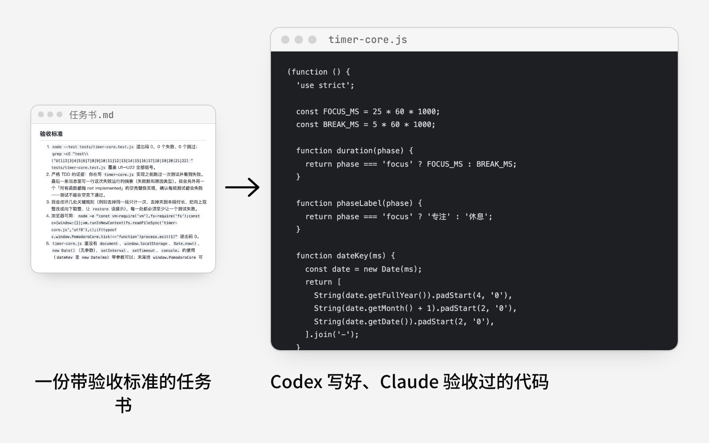</a><br><a href="skills/codex-delegate/"><b>codex-delegate</b></a> · Claude 派活给 Codex，自己验收<br><sub>一个 AI 又写代码又给自己验收，等于自己批改自己的作业，写错了也看不出来。这个 Skill 让 Claude 写好任务书（要做什么、只能动哪些文件、怎样才算做完），派给本机的 Codex 在后台写，Claude 盯着进度、收回结果后逐条按验收标准核对，不合格就把意见发回原会话返工，最多两轮。最后给出一份由另一个 AI 写、经过 Claude 独立验收的代码。</sub><br><sub><a href="skills/codex-delegate/examples/pomodoro/">看这个例子 →</a></sub></td></tr>
<tr><td width="50%" valign="top"><a href="skills/avatar-look/">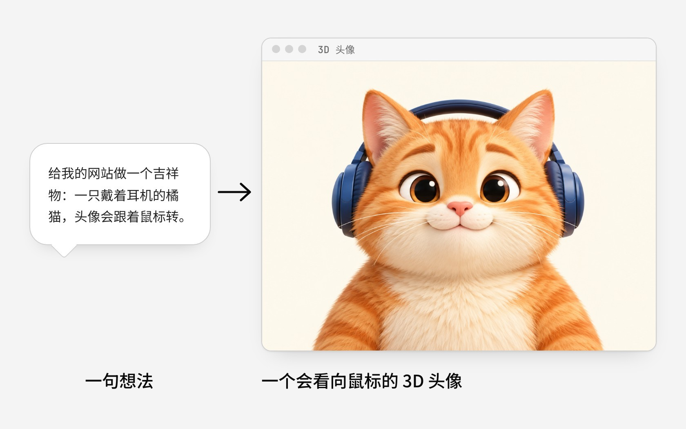</a><br><a href="skills/avatar-look/"><b>avatar-look</b></a> · 做一个看向鼠标的 3D 头像<br><sub>想给网站做个会动的头像，常见做法是找人建 3D 模型或写一堆动画代码，成本高还容易做得僵硬。这个 Skill 从一张照片或一句想法出发：先生成 3D 风格的头像图，再给你一段提示词去即梦生成「头绕一圈」的视频，拿回来自动处理成按角度排好的帧，产出一个能嵌进任何网页的组件，鼠标移到哪头就转向哪，最后自动验收转得顺不顺。最后给出一个会看向访客鼠标、放进网页就能用的 3D 头像。</sub><br><sub><a href="skills/avatar-look/examples/orange-cat/">看这个例子 →</a></sub></td><td width="50%"></td></tr>
</table>

### 知识整理

把书、论文、播客、代码仓库和一个想不清的问题，整理成能学、能复习、能拿来做决定的东西。

<table>
<tr><td width="50%" valign="top"><a href="skills/deep-survey/">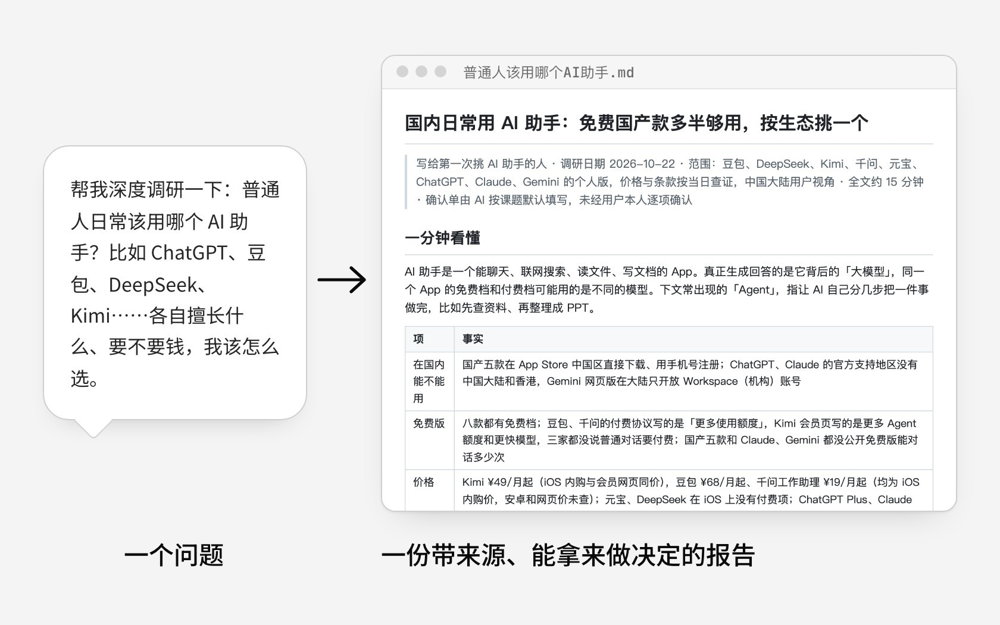</a><br><a href="skills/deep-survey/"><b>deep-survey</b></a> · 读完就能做决定的调研报告<br><sub>自己做调研，常常东搜一篇西看一篇，结论凭印象，数字说不清出处，写出来外行也看不懂。这个 Skill 先列一张确认单（写给谁、要做什么决定、查哪些对象、查多深），再派研究员分头查官网、条款、榜单这些一手资料并保存网页原件，交给一位没参与查资料的主笔按读者的问题写成报告，最后由独立审读员检查结论和依据对不对得上；报告里每个关键数字都能点回原文。最后给出一份外行读得懂、句句有出处、读完能做决定的调研报告。</sub><br><sub><a href="skills/deep-survey/examples/which-ai-assistant/">看这个例子 →</a></sub></td><td width="50%" valign="top"><a href="skills/book-to-mindmap/">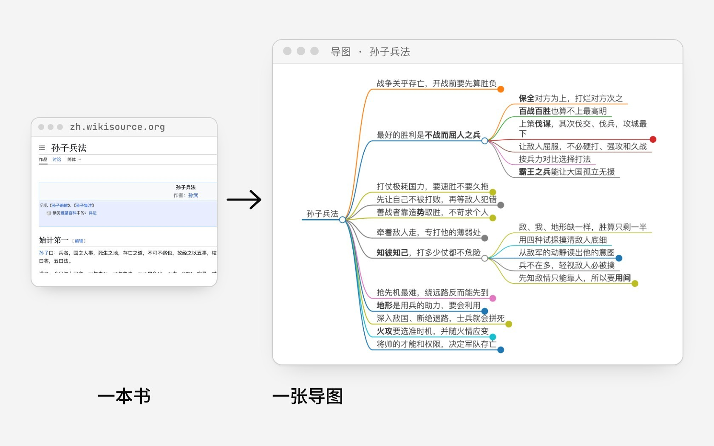</a><br><a href="skills/book-to-mindmap/"><b>book-to-mindmap</b></a> · 把一本书压成一张导图<br><sub>自己做导图常常照着目录拆，每个节点只放一个关键词，看完只记得讲了哪些话题，记不住结论。这个 Skill 让每个节点都写成一句能判断对错的话，解释放进备注；先搭好骨架请你确认，再一支一支往下填；最后让一个只看导图、没读过原书的 AI 来答题，答不上的地方回头补。最后给出一张不读原书也能看懂全书观点的导图。</sub><br><sub><a href="skills/book-to-mindmap/examples/sunzi-art-of-war/">看这个例子 →</a></sub></td></tr>
<tr><td width="50%" valign="top"><a href="skills/podcast-summary/">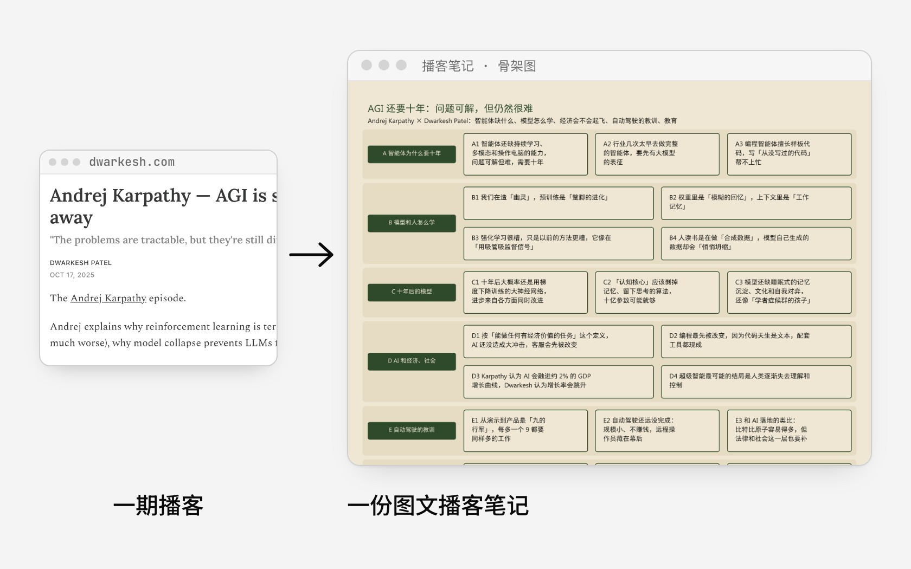</a><br><a href="skills/podcast-summary/"><b>podcast-summary</b></a> · 把一期播客整理成图文笔记<br><sub>听完一期长播客，过两天就只记得一两句，想复习又得重听。这个 Skill 读完整份文字稿，按听众会问的问题把内容重新分章，每章写成一句判断，画一张骨架图看全貌、一张总结图带走整期，再出一组带答案的问答；出完题让一个只看笔记、没听过节目的 AI 来答，答不上的地方回头补进正文。最后给出一份能学习、能复习、以后翻出来也能回顾的图文笔记。</sub><br><sub><a href="skills/podcast-summary/examples/dwarkesh-karpathy/">看这个例子 →</a></sub></td><td width="50%" valign="top"><a href="skills/paper-card/">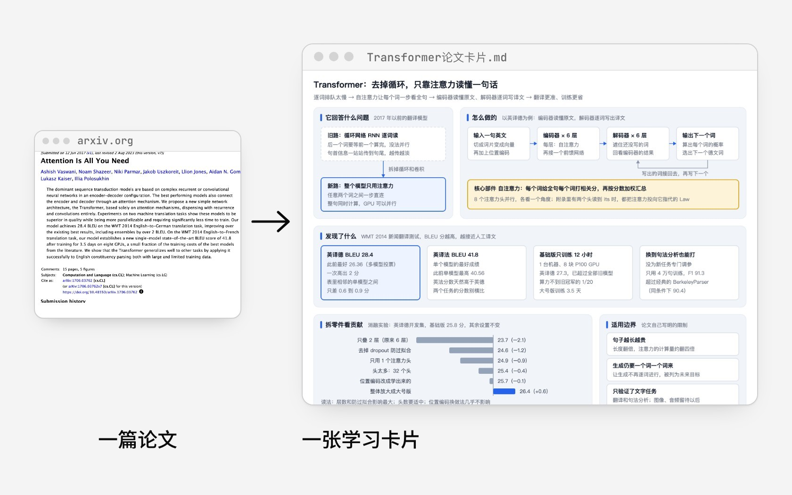</a><br><a href="skills/paper-card/"><b>paper-card</b></a> · 把论文读成一张学习卡片<br><sub>论文难读，多半卡在术语太多、数字不知道算高还是算低，读完也没留下能复习的东西。这个 Skill 按一套固定的卡片模板来读：先画一张结构图看全貌，再讲清它要解决什么问题、怎么做的、发现了什么；每个数字都说明跟谁比、算不算好，每个术语都换成白话。最后给出一张外行也看得懂、以后翻出来就能复习的学习卡片。</sub><br><sub><a href="skills/paper-card/examples/attention-is-all-you-need/">看这个例子 →</a></sub></td></tr>
<tr><td width="50%" valign="top"><a href="skills/knowledge-canvas/">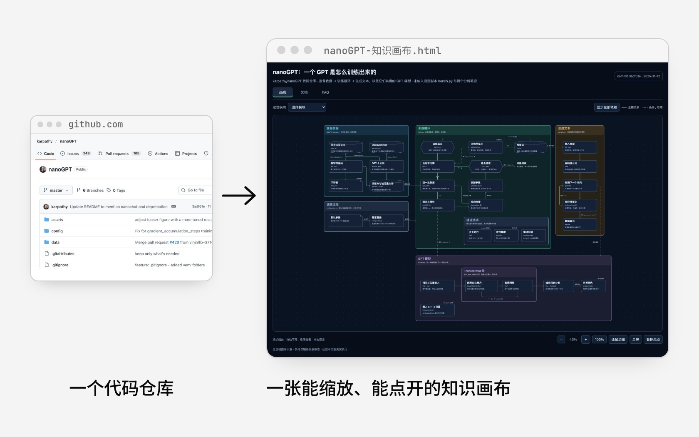</a><br><a href="skills/knowledge-canvas/"><b>knowledge-canvas</b></a> · 把代码仓库画成知识画布<br><sub>想弄懂一个陌生的代码仓库或一门课，常见做法是从头一路读下去，读到一半就分不清哪个模块管什么、数据从哪流到哪。这个 Skill 先把材料拆成模块和它们之间的关系，出一份结构稿请你确认，再生成一张能缩放、能拖动的画布：每个节点点开有中文说明和逐字截取的原文出处，旁边配一份同步的文档和有依据的常见疑问。最后给出一张一屏看全貌、点开看细节的知识画布。</sub><br><sub><a href="skills/knowledge-canvas/examples/nanogpt/">看这个例子 →</a></sub></td><td width="50%" valign="top"><a href="skills/lark-export/">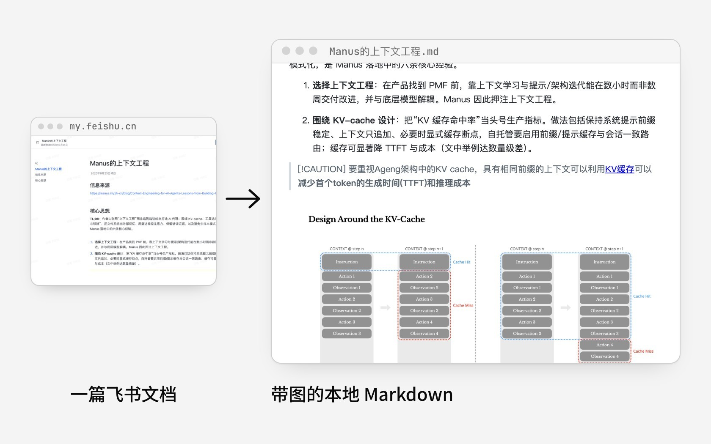</a><br><a href="skills/lark-export/"><b>lark-export</b></a> · 把飞书文档镜像成本地 Markdown<br><sub>飞书里的文档想存到本地、放进代码仓库或交给 AI 读，手动复制会丢格式，图片还留在飞书上，原文一改本地就过时。这个 Skill 把一整棵知识库或单篇文档镜像成本地 Markdown：标题层级、表格、提示块都转过来，图片和附件下载到旁边的文件夹、路径改成本地的；以后再跑同一条命令就能同步到最新。最后给出一份离线能看、能搜索、AI 能直接读的本地副本。</sub><br><sub><a href="skills/lark-export/examples/manus-context-engineering/">看这个例子 →</a></sub></td></tr>
</table>

### 写作发布

写小红书、公众号和工作文档，按各自的规矩排好、写好。

<table>
<tr><td width="50%" valign="top"><a href="skills/xhs-note/">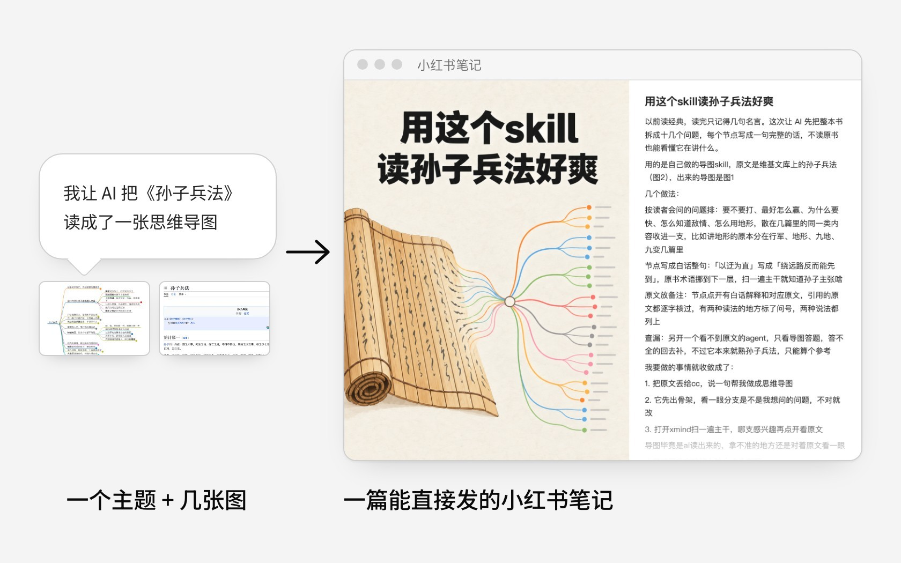</a><br><a href="skills/xhs-note/"><b>xhs-note</b></a> · 写一篇能直接发的小红书笔记<br><sub>自己写小红书笔记，常常不知道从哪开头，标题没人点，封面还要另外找人做，写出来一股 AI 味。这个 Skill 先问清你想表达什么、配图讲了什么，照你以前写过的笔记的口吻起草正文（分享工具和记录感悟是两种写法），给几个标题让你挑，再生成一张标题醒目的封面、配好标签。最后给出一篇封面、标题、正文、标签齐全，能直接发的笔记。</sub><br><sub><a href="skills/xhs-note/examples/sunzi-mindmap-note/">看这个例子 →</a></sub></td><td width="50%" valign="top"><a href="skills/wechat-publisher/">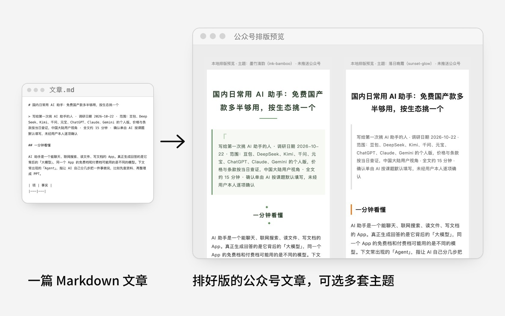</a><br><a href="skills/wechat-publisher/"><b>wechat-publisher</b></a> · 把文章排好版推进公众号草稿箱<br><sub>在公众号后台发文章，要一张张传图、一段段调格式，从别处复制过来的表格和链接经常排乱，发完还得自己想怎么转发。这个 Skill 先把文章整理成发布版，压缩图片传到图床，列出要你确认的校对清单，再套上排版主题（自带多套，可以一次出几份对比）推进公众号草稿箱，最后附上朋友圈和群聊两版推广文案和发布时间建议，只推草稿、不替你点发表。最后给出一篇排好版、等你检查后就能发的公众号文章。</sub><br><sub><a href="skills/wechat-publisher/examples/ai-assistant-article/">看这个例子 →</a></sub></td></tr>
<tr><td width="50%" valign="top"><a href="skills/pm-doc-write/">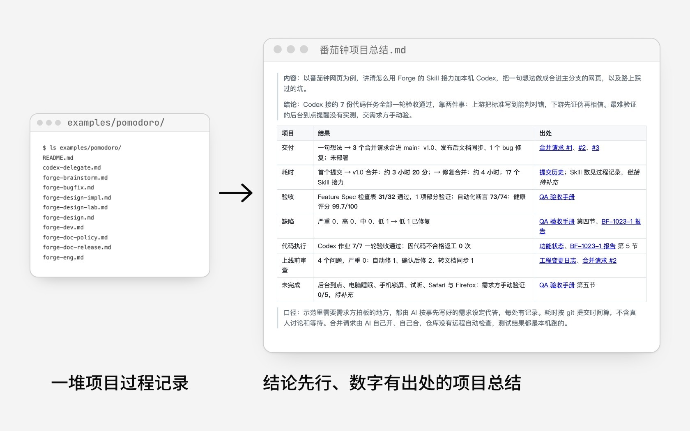</a><br><a href="skills/pm-doc-write/"><b>pm-doc-write</b></a> · 写结论先行的工作文档<br><sub>写周报、项目总结，常常先铺一大段背景，结论埋在最后，数字没有对比基线，谁负责也说不清，AI 代写的还一股模板味。这个 Skill 按场景选模板（周报、OKR、项目总结、评测结论等），照「结论先行、表格承载、数字带基线、责任到人」的规矩写，每个数字都要能找到出处，写完对照你自己的范文调口吻，再过一遍终审清单。最后给出一份读者看开头就知道结论、可以直接发出去的工作文档。</sub><br><sub><a href="skills/pm-doc-write/examples/pomodoro-summary/">看这个例子 →</a></sub></td><td width="50%"></td></tr>
</table>

### Skill 与 Prompt

做 Skill、写 prompt、收 prompt：给 AI 写说明书的三件事。

<table>
<tr><td width="50%" valign="top"><a href="skills/skill-build/">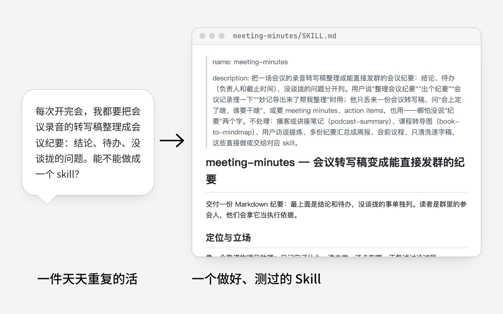</a><br><a href="skills/skill-build/"><b>skill-build</b></a> · 把重复的活做成测过的 Skill<br><sub>想把天天重复的活交给 AI，自己写的 skill 常常该用的时候不触发、不该用的时候乱触发，规则越堆越长，也说不清到底比不用强在哪。这个 Skill 先判断这件事值不值得做成 skill，再问清边界（哪些请求长得像但不归它管、出错了怎么办），出一份设计文档过完备性检查，然后才写 SKILL.md；写完自己造测试题，用和不用各跑几遍对比，需要时请不知情的评委盲评，按差在哪去改。最后给出一个触发准确、说得清比不用强在哪的 Skill。</sub><br><sub><a href="skills/skill-build/examples/meeting-minutes/">看这个例子 →</a></sub></td><td width="50%" valign="top"><a href="skills/prompt-craft/">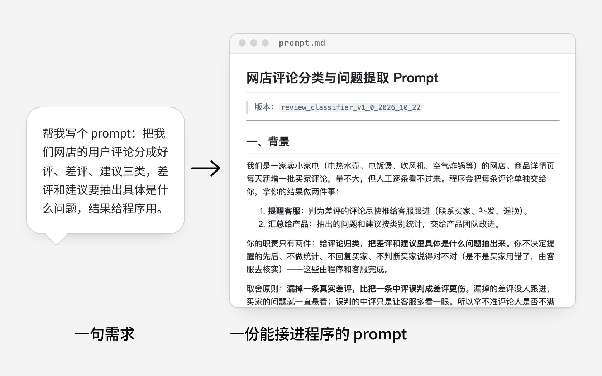</a><br><a href="skills/prompt-craft/"><b>prompt-craft</b></a> · 写能上线的 prompt<br><sub>手搓的 prompt 常写成「你是一位资深专家」「请输出高质量、准确的结果」，这些要求模型没法照着执行；结构也东一句西一句，空输入、长文被截断、内容里夹带指令这些情况都没考虑。这个 Skill 维护了一套固定的 prompt 结构和一份审查清单：先问清需求（结果给谁用、哪种错误更伤），再按九个模块（背景、角色、步骤、判断标准、样例、兜底、输入边界、输出格式等）写，写完换成审查者的眼光，拿边界输入、注入和模型的常见坏毛病逐项挑错。最后给出一份能稳定执行、考虑周全、细节足够的 prompt。</sub><br><sub><a href="skills/prompt-craft/examples/review-classifier/">看这个例子 →</a></sub></td></tr>
<tr><td width="50%" valign="top"><a href="skills/prompt-vault/">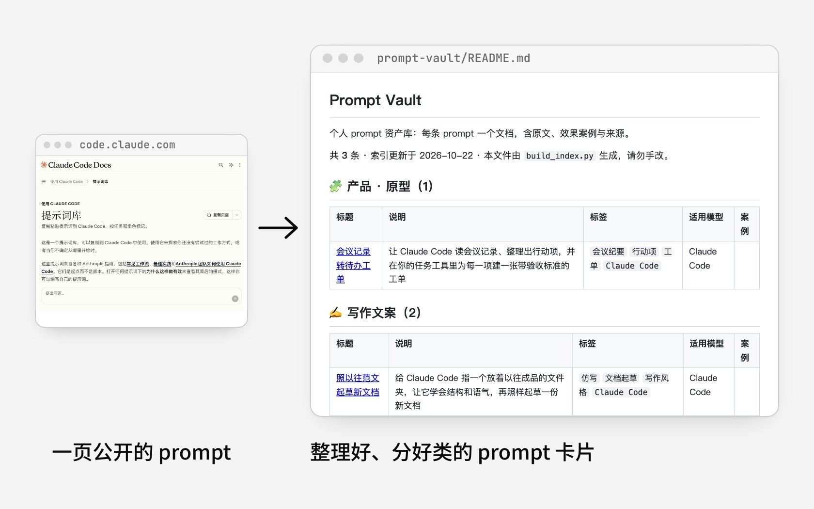</a><br><a href="skills/prompt-vault/"><b>prompt-vault</b></a> · 把看到的好 prompt 收进库<br><sub>在网上看到好用的 prompt，常常随手存进收藏夹或备忘录，过几天就找不到，找到了也忘了当初是在什么场景下用的、效果怎么样。这个 Skill 维护一个统一格式的 prompt 库：从网页或文章里把 prompt 原文完整摘出来，连同效果案例图和出处写成一张卡片，按用途归类，自动重建目录索引，再推到 GitHub 上。最后给出一个随时能查、拿来就能用的 prompt 库。</sub><br><sub><a href="skills/prompt-vault/examples/anthropic-prompt-library/">看这个例子 →</a></sub></td><td width="50%"></td></tr>
</table>

### 每个 Skill 怎么运转

下列结构图展示部分 Skill 的阶段、门禁、回退和产出。点图进 Skill 目录，看说明和完整的 SKILL.md。

<table>
<tr><td width="50%" valign="top"><a href="skills/avatar-look/"></a><br><a href="skills/avatar-look/"><b>avatar-look</b></a> · 会看向鼠标的 3D 头像组件</td><td width="50%" valign="top"><a href="skills/book-to-mindmap/"></a><br><a href="skills/book-to-mindmap/"><b>book-to-mindmap</b></a> · 书和长文转思维导图</td></tr>
<tr><td width="50%" valign="top"><a href="skills/codex-delegate/"></a><br><a href="skills/codex-delegate/"><b>codex-delegate</b></a> · 派活给 Codex，Claude 验收</td><td width="50%" valign="top"><a href="skills/deep-survey/"></a><br><a href="skills/deep-survey/"><b>deep-survey</b></a> · 带来源的深度调研报告</td></tr>
<tr><td width="50%" valign="top"><a href="skills/knowledge-canvas/"></a><br><a href="skills/knowledge-canvas/"><b>knowledge-canvas</b></a> · 资料整理成可缩放的知识画布</td><td width="50%" valign="top"><a href="skills/lark-export/"></a><br><a href="skills/lark-export/"><b>lark-export</b></a> · 飞书 wiki 镜像到本地 Markdown</td></tr>
<tr><td width="50%" valign="top"><a href="skills/paper-card/"></a><br><a href="skills/paper-card/"><b>paper-card</b></a> · 一篇论文读成一张学习卡片</td><td width="50%" valign="top"><a href="skills/pm-doc-write/"></a><br><a href="skills/pm-doc-write/"><b>pm-doc-write</b></a> · 按本人写法写周报、OKR、项目总结</td></tr>
<tr><td width="50%" valign="top"><a href="skills/prompt-craft/"></a><br><a href="skills/prompt-craft/"><b>prompt-craft</b></a> · 生产级 prompt 与对抗审查</td><td width="50%" valign="top"><a href="skills/skill-build/"></a><br><a href="skills/skill-build/"><b>skill-build</b></a> · 造 Skill：设计、评测、迭代</td></tr>
<tr><td width="50%" valign="top"><a href="skills/wechat-publisher/"></a><br><a href="skills/wechat-publisher/"><b>wechat-publisher</b></a> · Markdown 推成公众号草稿</td><td width="50%" valign="top"><a href="skills/xhs-note/"></a><br><a href="skills/xhs-note/"><b>xhs-note</b></a> · 写小红书笔记，含封面</td></tr>
</table>

## 已归档

暂时不维护的 skill 移到了 [`archive/`](./archive/)：不随 `install.sh` 安装，代码和文档原样保留，以后优化后可能移回 `skills/`。

- [prd-analyzer](./archive/prd-analyzer/)
- [project-context](./archive/project-context/)
- [project-learner](./archive/project-learner/)
- [repo-study](./archive/repo-study/)
- [staged-file-review](./archive/staged-file-review/)
- [twitter-watchdog](./archive/twitter-watchdog/)
- [work-logger](./archive/work-logger/)

## 安装

克隆仓库，用 `install.sh` 以 symlink 方式安装（不要手动 cp——复制副本会随源仓库更新而漂移）：

```bash
git clone https://github.com/antonailog/skills.git
cd skills

# 安装全部 skill 到 ~/.claude/skills
./install.sh

# 只安装指定 skill
./install.sh --only lark-export --only prompt-craft

# 查看安装状态（含坏链检测）/ 卸载
./install.sh --status
./install.sh --uninstall
```

Codex 用户加 `--target codex`（装到 `~/.agents/skills`），`--target both` 两边都装。

重启代理（或开新会话），skill 会在其触发词上激活。

## 配置与密钥

部分 skill 会调用第三方 API，需要凭证。**本仓库不包含任何密钥**——请自行提供：

| Skill | 需要设置 | 方式 |
|-------|----------|------|
| lark-export | `FEISHU_APP_ID`、`FEISHU_APP_SECRET`、`FEISHU_EXPORT_HOME` | 环境变量（见该 skill 的 `SKILL.md`） |
| wechat-publisher | `WECHAT_APP_ID`、`WECHAT_APP_SECRET`、`OSS_ACCESS_KEY_ID`、`OSS_ACCESS_KEY_SECRET`、`OSS_BUCKET` | 环境变量 |
| deep-survey | `ZHIHU_ACCESS_SECRET`（可选，知乎数据开放平台）；`INFO2ACTION_REPO`（可选，作者自用的信息流） | 环境变量，或写进 `~/.config/deep-survey/secrets.env`；都没有时自动退回网页搜索 |

`config/config.yaml`、`.env` 等本地密钥文件已被 git 忽略。

## 仓库结构

```
skills/
├── skills/
│   ├── <skill>/examples/  # 每个 Skill 一个真实跑过的例子：README + input/ + output/ + shots/
│   ├── _shared/     # 共享代码：figkit（图稿渲染成飞书画板 SVG 并校验），不是 skill，不随 install.sh 安装
│   ├── avatar-look/
│   ├── book-to-mindmap/
│   ├── codex-delegate/
│   ├── deep-survey/
│   ├── knowledge-canvas/
│   ├── lark-export/
│   ├── paper-card/
│   ├── pm-doc-write/
│   ├── podcast-summary/
│   ├── prompt-craft/
│   ├── prompt-vault/
│   ├── skill-build/
│   ├── wechat-publisher/
│   └── xhs-note/
├── archive/         # 已归档、暂不维护的 skill（不随 install.sh 安装）
├── docs/            # 部分 skill 的设计与评测记录
├── LICENSE
└── README.md
```

## 贡献

这些 skill 以现状分享，供参考与复用。欢迎提交改善可移植性或修复 bug 的 issue 与 PR。

## 许可

[MIT](./LICENSE) © 2026 yike-gunshi
