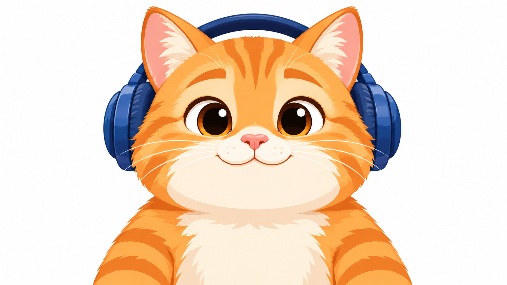
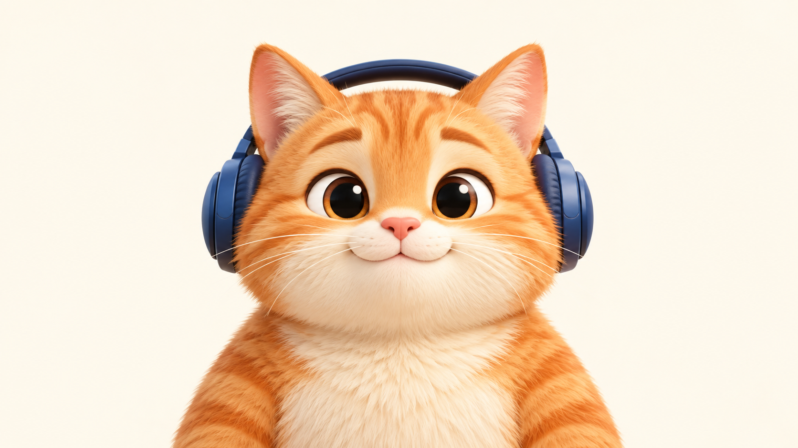

# 示范：一句话想法 → 会看向鼠标的 3D 橘猫头像

> 日期：2026-10-22
> 状态：进行中。第 1 步已完成，停在第 2 步，等用户去即梦生成「头绕一圈」的视频。

## 给了什么

只有一句话，没有照片，也没有参考图（原文存于 [input/想法.md](input/想法.md)）：

> 给我的网站做一个吉祥物：一只戴着耳机的橘猫，圆圆胖胖、表情友好，头像会跟着鼠标转。

## 用户会怎么说

在 Claude Code 里把上面这句话原样说出来就行，不用提 Skill 的名字。「头像会跟着鼠标转」这几个字就会让 AI 用上 avatar-look。想点名也可以说：「用 avatar-look 给我的网站做个吉祥物：一只戴着耳机的橘猫……」

## 从想法到 3D 头像

| 这个想法长什么样（2D 插画） | AI 出的 3D 头像（已选定） |
|---|---|
|  |  |

说明：Skill 是直接从文字想法出 3D 图的，不需要先画 2D。左边这张 2D 插画是为了展示「这个想法长什么样」，照着选中的 3D 猫另画的同一个形象，不参与后续流程。

## 进度

| 步骤 | 谁来做 | 状态 |
|---|---|---|
| 1. 出 3D 头像图 | AI | 已完成 |
| 2. 用即梦生成「头绕一圈」的视频 | 用户（AI 做不了） | **等用户，现在停在这里** |
| 3. 处理视频：裁切、量出每一帧头朝哪 | AI | 未开始 |
| 4. 产出能嵌进网页的头像组件 | AI | 未开始 |
| 5. 验收：自动测试 + 用户亲手试手感 | AI 和用户 | 未开始 |

## 第 1 步具体做了什么

- 用 Skill 的「想法版」提示词：把这句话展开成形象描述（橘色条纹、奶白色口鼻和胸口、大眼睛、深蓝色头戴式耳机），其余部分照抄 Skill 的模板。
- 第一轮出了三张（候选-1 到候选-3）：正脸、居中、纯色背景都合格，但猫耳尖离画面顶边太近，没达到 Skill「头顶要留出空白」的要求。
- 第二轮在形象描述里补了一句「竖起的猫耳尖就是头顶的最高点，整只猫别撑得太满」，又出三张（候选-4 到候选-6）。顶部留白有改善，但仍比 Skill 的标准紧一些。
- 因为这是动物形象，额外做了两项检查（Skill 只在后面的步骤里提醒过这类风险）：
  - 用第 3 步同款的人脸识别工具试了全部六张，卡通猫脸都能被认出来，后面处理视频时不会卡在「认不出脸」。
  - 按第 3 步的裁切方式套上圆形头像框预览，候选-4 的两只耳朵和耳机都完整地在框里。
- 选定候选-4，另存为 `output/3D头像-选中.png`。

## 还差什么

1. 用户照 [input/即梦操作.md](input/即梦操作.md) 去即梦生成视频，挑一条合格的。
2. 把挑中的视频放到 `input/绕圈视频.mp4`。
3. 对 AI 说一句「橘猫的视频放好了，继续做」。之后的处理视频、产出组件、自动验收由 AI 接着做，最后请用户亲手试手感。

## 演示时由 AI 代为确认的地方

Skill 流程里本该由用户拍板的地方，这次演示都按 Skill 的默认做法处理：

- 产出目录放哪（Skill 要求先问用户）：由发起这次演示的人指定为本目录，不是 AI 自己挑的。
- 第一轮三张都没达到「头顶留白」，要不要重出：演示时由 AI 按默认确认（按挑选标准重出一轮）。
- 3D 头像挑哪张、满不满意：演示时由 AI 按默认确认（选候选-4：顶部留白最多，套上圆框后耳朵和耳机都完整）。
- 候选-4 的顶部留白仍比标准略紧，是否接受：演示时由 AI 按默认确认（接受。猫耳尖落在圆形头像框的边角之外，就算视频里耳尖略微出画，头像框里也看不到；真出了问题再回第 1 步重出）。
- 即梦提示词里的配饰：Skill 原文写的是「帽子和眼镜」，本例换成橘猫身上的「耳机」，其余一字未改：演示时由 AI 按默认确认。
- 生成视频这一步不由 AI 代做，也不假装做过：这是 Skill 的红线，必须用户亲手完成。

## 文件

```
orange-cat/
├── README.md                 本说明
├── input/
│   ├── 想法.md               用户给的那句话
│   ├── 橘猫-2D形象.png        同一形象的 2D 插画（展示用）
│   └── 即梦操作.md            给用户的即梦设置、提示词、挑选标准
└── output/
    ├── 候选-1.png ～ 候选-3.png   第一轮 3D 候选
    ├── 候选-4.png ～ 候选-6.png   第二轮 3D 候选
    └── 3D头像-选中.png            选中的那张（即候选-4）
```
