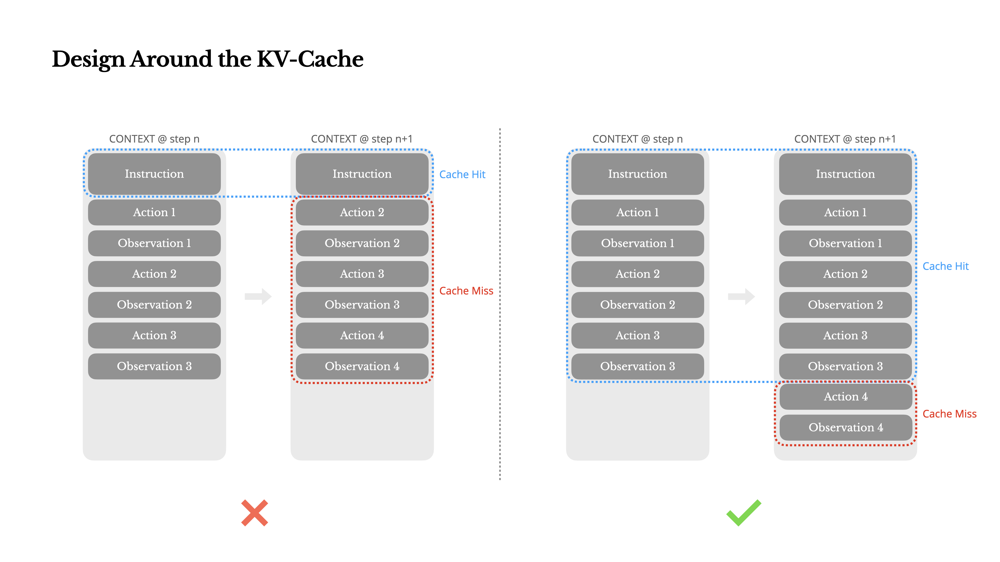

# 示范：把一篇飞书文档导出成带图的本地 Markdown

给 lark-export 一个飞书文档链接，得到一份本地 Markdown，文中的图片一起下载到旁边的文件夹里，离线能看、能搜索、能放进仓库。这是一次真实运行的完整记录，日期 2026-10-22。

## 给了什么

一篇公开的飞书知识库文档（链接也存在 [input/来源.md](input/来源.md)）：

- **标题**：Manus的上下文工程
- **链接**：https://my.feishu.cn/wiki/KZxnwhdZOinqNLkkqNWccAHxn1b
- **出处**：作者的公开知识库「阿東的AI手记」，这篇整理自 Manus 官方博客

### 为什么选这篇

- 话题是 AI 圈最近常聊的「上下文工程」，正文不长，先给一句话总结，再分条讲，没有技术背景也能顺着读完。
- 文中有几张示意图。导出后图片落在本地文件夹里，打开 Markdown 就能看到，一眼看得出图片也导出了。
- 图片都是原文配图，不是屏幕截图；正文里只有公开链接，不涉及个人信息、工作内容或内部项目。
- 文档在公开知识库里，任何人都能点开链接，和导出结果对照着看。

## 用户会怎么说这句话

在 Claude Code 里贴上链接，说想要本地版就行：

```text
把这篇飞书文档导出到本地，图片也下载下来：https://my.feishu.cn/wiki/KZxnwhdZOinqNLkkqNWccAHxn1b
```

「备份那篇文档」「把这篇拉到本地」这类说法也会触发这个 Skill，不必说「导出」两个字。也可以点名调用 `/lark-export`。

## 怎么调用的

1. **加载环境**：用 Skill 自带的脚本找到本机的导出工具，并从本机的 MCP 配置里读出飞书应用凭证。凭证只在运行时读取，不写进 Skill，也不写进这个目录。
2. **检查登录态**：下载图片要用用户登录态。这次本机登录态已经过期，工具用本机保存的续期凭据自动续上了，没有弹出浏览器登录。
3. **查文档 ID**：知识库链接里是节点编号，先用它查到这篇文档本身的 ID。
4. **单篇导出**：在 `output/` 目录里运行 Skill 的单篇导出命令，打开「下载图片」和「文件头」两个选项：

```bash
cd output
"$FEISHU_EXPORT_HOME/bin/feishu-cli" doc export <文档 ID> \
  -o "Manus的上下文工程.md" \
  --download-images \
  --assets-dir "Manus的上下文工程.assets" \
  --front-matter \
  --user-access-token "<运行时从本机登录态读取>"
```

5. **核对**：确认图片引用指向本地文件，没有残留飞书内部的图片地址；逐张看过图片，正文里也没有手机号、邮箱、内部链接之类的个人信息。

## 代确认了哪些门禁

Skill 有几处要用户拍板。这次是演示，由 AI 扮演用户，按默认值作答。

- **输出目录**：Skill 规定，用户没指定目录时先按项目结构推荐一个，确认后再拉。这次直接用本示范的 `output/`，不碰本机已有的飞书镜像目录。演示时由 AI 按默认确认。
- **导出范围**：知识库链接既可以导出整棵子树，也可以只导这一篇。用户只要这一篇，所以走单篇导出，不连带拉取同级和下级文档。演示时由 AI 按默认确认。
- **导出选项**：照 Skill 单篇命令的写法，下载图片、加文件头。演示时由 AI 按默认确认。
- **登录授权**：Skill 规定登录态缺失或过期时，要用户在浏览器里重新登录。这次靠自动续期解决了，没有走到这一步。如果续期也失效，需要用户本人登录一次，AI 不能代办。

## 和 Skill 默认做法不同的地方

- **用相对路径调用**：Skill 文档里的单篇命令用的是完整路径。完整路径会原样写进 Markdown 的图片链接，带出本机用户名，换台电脑或放到 GitHub 上就显示不出图。这次进到 `output/` 里、用相对路径运行，图片链接就是相对路径，放到哪里都能显示。

## 得到了什么

```text
manus-context-engineering/
├── README.md
├── input/
│   └── 来源.md
└── output/
    ├── Manus的上下文工程.md          ← 导出的正文
    └── Manus的上下文工程.assets/     ← 文中配图，原图下载到本地
```

**正文**：[output/Manus的上下文工程.md](output/Manus的上下文工程.md)

- 标题层级、加粗、编号列表、代码块、外部链接都保留了。
- 飞书的高亮提示块转成了 GitHub 的提醒块，在 GitHub 上显示成带颜色的提示框。
- 文件开头有标题和飞书文档 ID，以后能追回原文。
- 每张图在原文的位置上，用相对路径引用本地图片。

**图片**：[output/Manus的上下文工程.assets/](output/Manus的上下文工程.assets/)，下载的是飞书里存的原图。导出后其中一张长这样：



## 局限与说明

- 单篇导出的文件头只有标题和文档 ID，没有原文链接；原文链接记在 [input/来源.md](input/来源.md)。整库导出时会写上原文链接。
- 导出结果是原文的只读镜像，原文怎么写就怎么导，笔误也照搬。飞书上改了原文，重跑同一条命令就会覆盖更新。
- 正文和配图的内容来自 Manus 官方博客，版权归原作者；这里只用来演示导出效果。
