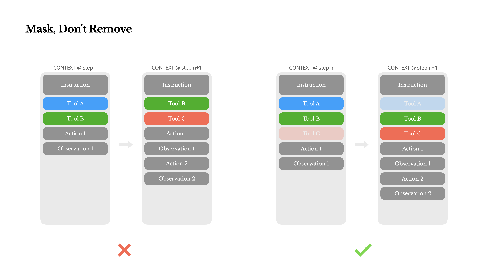
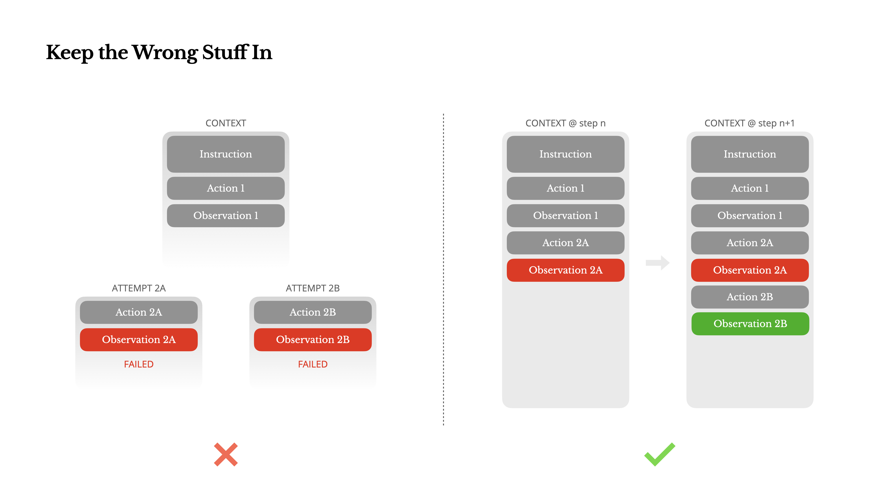

# 信息来源

https://manus.im/zh-cn/blog/Context-Engineering-for-AI-Agents-Lessons-from-Building-Manus

# 核心思想

**TL;DR**：作者主张用“上下文工程”而非端到端训练来打造 AI 代理；围绕 KV-cache、工具选择的“遮蔽而非移除”、把文件系统当外部记忆、用复述操控注意力、保留错误证据，以及避免少样本模式化，是 Manus 落地中的六条核心经验。  

1. **选择上下文工程**：在产品找到 PMF 前，靠上下文学习与提示/架构迭代能在数小时而非数周交付改进，并与底层模型解耦。Manus 因此押注上下文工程。  

1. **围绕 KV-cache 设计**：把“KV 缓存命中率”当头号生产指标。做法包括保持系统提示前缀稳定、上下文只追加、必要时显式缓存断点，自托管要启用前缀/提示缓存与会话一致路由；缓存可显著降 TTFT 与成本（文中举例达数量级差）。  

> [!CAUTION]
> 要重视Ageng架构中的KV cache，具有相同前缀的上下文可以利用[KV缓存](https://medium.com/@joaolages/kv-caching-explained-276520203249)可以**减少首个token的生成时间(TTFT)和推理成本**


1. **遮蔽，而非移除工具**：迭代中动态加减工具会破坏缓存并让模型困惑。Manus 用 logits 掩蔽与响应预填充来“约束可选动作集合”，而不是改写工具清单。  

> [!CAUTION]
> 动态加载工具单（比如MCP），一次性加载全部工具会增加上下文信息



调用工具的方式：**自动、必须、指定**

```plaintext
自动 – 模型可以选择调用或不调用函数。通过仅预填充回复前缀实现：<|im_start|>assistant
•必需 – 模型必须调用函数，但选择不受约束。通过预填充到工具调用令牌实现：<|im_start|>assistant<tool_call>
•指定 – 模型必须从特定子集中调用函数。通过预填充到函数名称的开头实现：<|im_start|>assistant<tool_call>{"name": "browser_
通过这种方式，我们通过直接掩码token的logits来约束动作选择。例如，当用户提供新输入时，Manus必须立即回复而不是执行动作。我们还有意设计了具有一致前缀的动作名称——例如，所有与浏览器相关的工具都以browser_开头，命令行工具以shell_开头。这使我们能够轻松确保代理在给定状态下只从特定工具组中进行选择而无需使用有状态的logits处理器。
```

1. **把文件系统当“终极上下文”**：长上下文既贵又易衰减。让代理按需读写文件，把网页/文档内容做“可恢复的压缩”（保留 URL 或路径即可回填），以持久、无限、可操作的外部记忆替代超长提示。  

1. **用复述操控注意力**：持续维护/重写 todo 清单，把全局目标复述到序列末端，避免长链路任务中“丢目标”。 

> [!CAUTION]
> 无论是编程还是Agent任务，新建一个todo列表都有助于LLM定期刷新“目标”，进而保持稳定 

1. **保留失败证据**：别抹去错误与堆栈；把失败尝试保留在上下文中可更新模型“内部信念”，提高恢复与纠错能力；错误恢复是“真代理”关键指标。  



1. **警惕少样本陷阱**：上下文里同质示例太多会诱发模式跟随与幻觉。通过在行动/观察的序列化与措辞上注入小幅结构化多样性来打破惯性。  

1. **结语**：更强更便宜的模型并不能替代对“记忆—环境—反馈”的工程；上下文形态最终决定代理的速度、鲁棒性与可扩展性。  
