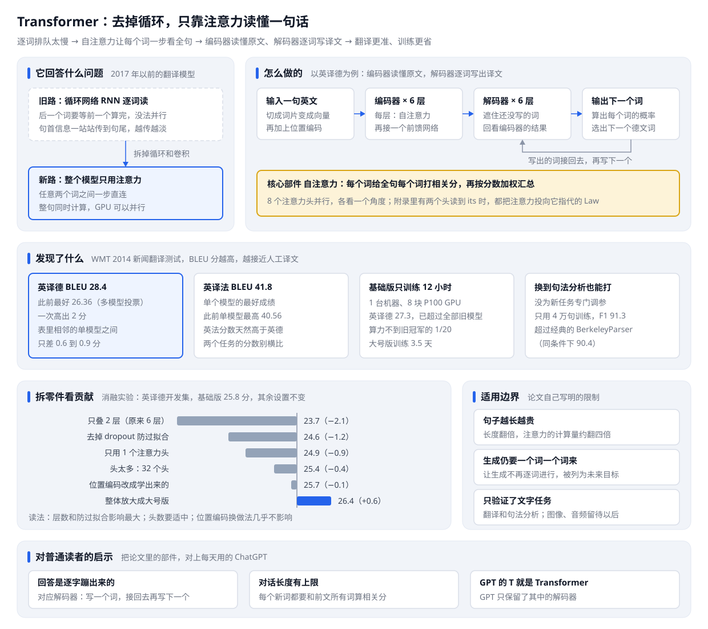

# 示范例子：Attention Is All You Need

给 paper-card 一篇论文，得到一张普通人也看得懂的学习卡片。

## 给了什么

- 一篇论文：[Attention Is All You Need](https://arxiv.org/abs/1706.03762)，ChatGPT 这类大模型背后的 Transformer 论文
- [shots/input.png](shots/input.png)：论文在 arXiv 上的摘要页截图，只用来展示输入长什么样。论文版权归原作者，仓库里不存 PDF 和论文页面，读原文请走上面的链接

## 怎么调用的

用户在 Claude Code 里说一句：

> 读一下这篇论文，整理成一张学习卡片：https://arxiv.org/abs/1706.03762

Claude 按 paper-card 的流程走完：认出资料类型，下载全文逐项核实，写卡片，画结构图，用无头浏览器截图自查，最后交付。

## 代确认的门禁

这次没有真人在场，Skill 里需要用户拍板的地方由 Claude 代为确认，每处一行：

- 读者：Skill 默认写给产品经理，本例改为听说过 ChatGPT、但没读过论文的普通技术爱好者
- 资料类型：认作方法论文，按 Skill 的类型表把重心放在机制怎么运转和消融实验
- 启示写给谁：Skill 要求先问用户想关联到什么工作，本例代答为一个想理解大模型的普通读者，不关联任何个人项目
- 交付形式：选 Skill 默认的本地 markdown 加 SVG 结构图，中文文件名，不发飞书
- 交付确认：结构图截图自查通过后（文字不溢出、箭头贴住卡片、底板不重叠、黄色高亮全图唯一），代用户确认收下
- 存放位置：Skill 没有规定默认目录，本例统一写进这个示范目录的 output/

## 得到了什么

- [output/Transformer论文卡片.md](output/Transformer论文卡片.md)：一张学习卡片。开头是论文出处和信息深度，接着是结构图，正文依次讲它回答什么问题、怎么做的、发现了什么、边界与没解决的问题、它和 ChatGPT 的关系、关键名词、对普通读者的启示。论文里的数字都带读法，告诉读者这个数算高算低、在跟谁比
- [output/Transformer结构图.svg](output/Transformer结构图.svg)：卡片的可视化目录，一张图看全貌：旧做法和新做法、模型怎么运转、主要结果、拆零件实验、适用边界、对读者的启示

卡片里的数字都回原文核对过。论文正文和表格有一处数字对不上，卡片里写明了以表格为准；论文之外的背景（它和 ChatGPT 的关系）单独成节并标明出处。

## 日期

2026-10-22
