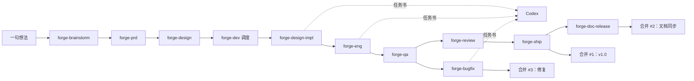

<!-- 飞书文档标题：番茄钟项目总结 -->

<!-- 此处为 callout -->
> **内容**：以番茄钟网页为例，讲清怎么用 Forge 的 Skill 接力加本机 Codex，把一句想法做成合进主分支的网页，以及路上踩过的坑。
>
> **结论**：Codex 接的 **7 份**代码任务全部一轮验收通过，靠两件事：上游把标准写到能判对错，下游先证伪再相信。最难验证的后台到点提醒没有实测，交需求方手动验。

| 项目 | 结果 | 出处 |
|---|---|---|
| 交付 | 一句想法 → **3 个**合并请求合进 main：v1.0、发布后文档同步、1 个 bug 修复；未部署 | [合并请求 #1](https://github.com/antonailog/forge-demo-pomodoro/pull/1)、[#2](https://github.com/antonailog/forge-demo-pomodoro/pull/2)、[#3](https://github.com/antonailog/forge-demo-pomodoro/pull/3) |
| 耗时 | 首个提交 → v1.0 合并：约 **3 小时 20 分**；→ 修复合并：约 **4 小时**；**17 个** Skill 接力 | [提交历史](https://github.com/antonailog/forge-demo-pomodoro/commits/main)；Skill 数见[过程记录](https://github.com/antonailog/forge-skills/tree/main/examples/pomodoro) |
| 验收 | Feature Spec 检查表 **31/32** 通过，1 项部分验证；自动化断言 **73/74**；健康评分 **99.7/100** | [QA 验收手册](https://github.com/antonailog/forge-demo-pomodoro/blob/main/docs/QA.md) |
| 缺陷 | 严重 0、高 0、中 0、低 1 → 低 1 已修复 | [QA 验收手册](https://github.com/antonailog/forge-demo-pomodoro/blob/main/docs/QA.md) 第四节、[BF-1023-1 报告](https://github.com/antonailog/forge-demo-pomodoro/blob/main/docs/archive/raw/bugfix-reviews/BF-1023-1.md) |
| 代码执行 | Codex 作业 **7/7** 一轮验收通过；因代码不合格返工 **0** 次 | [功能状态](https://github.com/antonailog/forge-demo-pomodoro/blob/main/.features/pomodoro-timer/status.md)、[BF-1023-1 报告](https://github.com/antonailog/forge-demo-pomodoro/blob/main/docs/archive/raw/bugfix-reviews/BF-1023-1.md) 第 5 节 |
| 上线前审查 | **4 个**问题，严重 0：自动修 1、确认后修 2、转文档同步 1 | [工程变更日志](https://github.com/antonailog/forge-demo-pomodoro/blob/main/docs/ENGINEERING-CHANGELOG.md)、[合并请求 #2](https://github.com/antonailog/forge-demo-pomodoro/pull/2) |
| 未完成 | 后台到点、电脑睡眠、手机锁屏、试听、Safari 与 Firefox：需求方手动验证 **0/5**，*待补充* | [QA 验收手册](https://github.com/antonailog/forge-demo-pomodoro/blob/main/docs/QA.md) 第五节 |

> 口径：示范里需要需求方拍板的地方，都由 AI 按事先写好的需求设定代答，每处有记录。耗时按 git 提交时间算，不含真人讨论和等待。合并请求由 AI 自己开、自己合，仓库没有远程自动检查，测试结果都是本机跑的。


# 一、概念介绍

**Forge 是什么？**

Forge 是一组按开发阶段拆开的 Skill。每个 Skill 只管一个阶段：读上一步留下的文档，交出这一步的文档或代码，再交给下一个 Skill。番茄钟这次从搭文档目录开始，经过讨论需求、写 PRD、做设计、写代码、验收、审查、发布，一直走到修 bug，每一步的产物都留在[项目仓库](https://github.com/antonailog/forge-demo-pomodoro)里。

> 打个比方：Forge 像装修队的一张工序单。量房、出图、施工、监理各有专人，前一道工序交出图纸，后一道工序照图干活，监理不听口头汇报，自己拿尺子量。

这次的输入只有需求方的一句话：

> 我想做一个番茄钟网页，专心工作 25 分钟、休息 5 分钟，能看到今天完成了几个。

另附一份需求设定：必须打开就能用、能开始暂停跳过、到点有提醒、刷新不丢当天记录、手机上能看；不要账号、云同步、团队协作、广告和统计大屏；纯前端静态网页，审美要简洁、安静。

<!-- 此处发布时转为飞书画板：Skill 接力流程 -->


| 阶段 | 用到的 Skill | 核心目标 | 这次交出什么 |
|---|---|---|---|
| 搭架子 | forge-doc-policy | 定好文档放哪 | 文档入口、索引、功能登记表 |
| 想清楚 | forge-brainstorm | 挑战前提，选方案 | 需求讨论：3 个方案、对抗性审查 |
| 定需求 | forge-prd、forge-feature-doc | 写成能判对错的行为契约 | PRD、Feature Spec（R1–R6、32 项验收检查表）、给人看的需求设计文档 |
| 定设计 | forge、forge-design、forge-design-lab | 在真实尺寸上定比例 | DESIGN.md、设计工作台骨架、token |
| 写代码 | forge-dev 调度 forge-design-impl、forge-eng，经 codex-delegate 派给 Codex | 照文档施工 | 页面、计时规则、22 个单测、工程文档 |
| 验收 | forge-qa | 逐项给结论和证据 | QA 验收手册、验收脚本、截图 |
| 发布 | forge-review、forge-ship、forge-doc-release | 审代码、合并、同步文档 | 合并请求 #1、#2 |
| 维护 | forge-bugfix、forge-status | 修 bug、巡检并行会话 | 合并请求 #3 |

> 出处：[功能状态](https://github.com/antonailog/forge-demo-pomodoro/blob/main/.features/pomodoro-timer/status.md)、[Feature Spec](https://github.com/antonailog/forge-demo-pomodoro/blob/main/.features/pomodoro-timer/feature-spec.md)；Skill 名单见[各 Skill 过程记录](https://github.com/antonailog/forge-skills/tree/main/examples/pomodoro)。

**人和 AI 各干什么？**

需求方只给想法和设定；Claude 运行 Skill，负责讨论、写文档、给 Codex 写任务书、验收和提交；Codex 只按任务书写代码。

| 角色 | 做什么 | 不做什么 |
|---|---|---|
| 需求方 | 给一句想法和需求设定，在门禁处拍板（这次由 AI 按设定代答） | 不写文档、不写代码 |
| Claude（运行 Skill） | 讨论需求、写文档、写任务书、验收、提交、开合并请求 | 页面和业务代码不自己写 |
| Codex（本机） | 按任务书写页面、样式、计时规则和测试 | 不提交、不推送；沙箱里打不开浏览器，不做页面验收 |

# 二、方法论

**每个阶段交出什么，下一步才能一次做对？**

番茄钟这次的经验是，每个阶段都要回答三个问题：以什么为准、拿什么验证、什么算过。三个问题答清楚，下一个 Skill 或 Codex 就能照着做，做完也有办法判对错。**标准写到能判对错，执行的人才能一次做对**。

| 阶段 | 标准：以什么为准 | 证据：拿什么验证 | 判据：什么算过 |
|---|---|---|---|
| 需求 | Feature Spec：每块功能的正常、异常、边界场景和验收检查表 | 派独立审查者挑刺；写代码前对照规格逐条找空白 | 每条规则能判对错；空白在写代码前定好口径 |
| 设计 | DESIGN.md 和工作台导出的 token | 真实尺寸的骨架，桌面、手机竖屏、手机横屏逐个看 | 各尺寸放得下；真页面和骨架的锚点误差 ≤ 2px |
| 实现 | 任务书：以哪份文档为准、只许改哪些文件、哪条命令必须成功 | 空壳实现、故意改坏规则、派活方亲自重跑和截图 | 空壳下测试全部失败；每处改坏都有测试报警 |
| 验收 | 验收检查表加 DESIGN 的具体数值 | 假时钟快进、真实等待、读浏览器计算样式 | 每项都有结论和证据；测不了的写明差在哪 |
| 发布与维护 | 分支从分叉点以来的改动 | 合并前重跑单测和回归；主线变了重新验收 | 合并请求写明测试情况和已知限制；没有远程检查就不写已通过 |

> 锚点误差的口径出自 [QA 验收手册](https://github.com/antonailog/forge-demo-pomodoro/blob/main/docs/QA.md) 第三节 V16。

实现那一行最关键。Codex 7 份作业都一轮通过，前提是任务书把接口和规则口径写到了函数级，验收时 Claude 又用空壳和改坏规则证明测试真能抓错，见 4.2。

# 三、项目实践踩过的坑

1. **踩了什么坑**：番茄钟在 Skill 交接上主要踩了两类坑。一是 Skill 的默认场景和项目对不上：工程、验收、审查、发布几个 Skill 的模板和检查清单按带后端的网页应用来写，大半篇幅是接口、数据库和服务器部署，设计实现默认已经有页面，全新的纯静态单页只能逐项判断跳过。二是 Skill 之间的交接点没有归属：在哪个分支提交、并行会话怎么登记、设计偏离由谁拍板、合并后由谁收尾，各 Skill 都没写。以上两类坑导致一处设计偏离带着发布了 v1.0，并行的修复在合并时冲突、按新写法重写了一遍，发布后的文档同步多开了一个合并请求。
2. **踩坑的原因**：主要有两点。一是每个 Skill 按单个阶段来写，只检查自己这一步做得对不对，一步和下一步怎么衔接没人写，**每个 Skill 只管自己这一步，交接处就没人管**。二是 Skill 的模板和检查清单以带后端、已有代码的项目为默认，从零开始的纯静态页面落在默认值之外，示范时只能由 AI 自己判断怎么裁剪。

| 环节 | 踩坑做法 | 后果 | 理想做法 | 负责 Skill |
|---|---|---|---|---|
| 设计实现在哪提交 | 只写原子提交，没写在哪个分支 | 照字面会直接提交到 main；这次由调度器指定隔离副本才避开 | 写代码的 Skill 一律先建隔离副本 | forge-design-impl |
| 设计偏离归谁 | 设计实现引入切阶段换色过渡；工程记待拍板、验收判低级别失败，都默认接受 | v1.0 带着偏离合并，用户反馈后才修 | 偏离从发现起有唯一负责 Skill，由它拍板改文档或交实现修 | forge-design |
| 并行会话登记 | 只有 forge-bugfix 会写占用登记表 | forge-status 判成没有并行；审查和修复改了同一个函数，合并时才发现 | 所有改代码的会话都登记占用范围 | forge-status、forge-dev |
| 合并前验收 | 主线变了只要求解决冲突再合并 | 照字面执行，没验过的修复会合进去 | 解决冲突后重跑回归、重新验收 | forge-bugfix |
| 审查看哪些改动 | 拿分支和 main 现在的样子直接比 | 误报两份状态文件被删了一大段 | 只看分支从分叉点以来的改动 | forge-review、forge-ship |
| 发布后文档同步 | 完整发布一口气合并，文档同步在合并后才跑 | 多开 1 个合并请求 #2 | 文档同步排在合并之前，或写明合并后怎么跑 | forge-ship、forge-doc-release |
| 合并后收尾 | 合并完就结束，不更新登记表、不处理隔离副本 | [功能登记表](https://github.com/antonailog/forge-demo-pomodoro/blob/main/.features/_registry.md)合并后仍显示进行中 | 合并后更新登记表，隔离副本交 forge-status 清理 | forge-ship |

> 出处：[各 Skill 过程记录](https://github.com/antonailog/forge-skills/tree/main/examples/pomodoro)的问题一节；功能登记表见上方链接。

# 四、更理想的做法

## 4.1 理想态定义：把标准写到下游能照做

### 4.1.1 需求：规格空白在写代码前补齐

1. **原则**：需求阶段交出的是一份能判对错的行为契约。规格没写到的情形留给写代码的人自己猜，猜的结果会被测试写成规格，要到审查阶段才可能被发现，见 4.2.2 的 U7。
2. **番茄钟项目经验**：
   1. **做法**：forge-brainstorm 走产品模式，追问 6 个问题、出 3 个方案，再派一个独立审查者专门挑刺；forge-prd 把结论写成 Feature Spec，R1–R6 六块功能各有正常、异常、边界场景，末尾是 32 项验收检查表。
   2. **问题1**：第一轮讨论把刷新当成用户自己的操作，定了刷新后正在走的那一段作废。浏览器自己也会重新加载页面，照这条做，该算的完成数会漏记。
   3. **优化1**：审查者提出 6 条意见：采纳 4 条，其中 1 条推翻了原来的刷新规则，改为刷新后接着走；不采纳 1 条，它建议砍掉手机适配，需求方点名要手机能看；另有 1 条记为假设。forge-prd 的假设审查又补了 2 条：浏览器不一定能保存记录、同事可能开两个页面。
   4. **问题2**：Feature Spec 写完仍有 3 种情形没写到：两个页面恢复的是同一段专注，各自到点时算几个；到点提示在刷新后还要不要保留；刚好到点那一刻按下按钮算什么。
   5. **优化2**：forge-eng 写代码前的四章审查对照 Feature Spec 找出这 3 处，按最不打扰用户的口径补齐，写进工程文档的规则口径表，再由 forge-qa 逐条验证。规格空白 **8 处** → 写代码前定好口径 **8 处**，QA 验证 **7 处**通过、**1 处**部分验证。

| 谁发现 | 空白 | 补齐的口径 | QA 结论 |
|---|---|---|---|
| 对抗性审查（forge-brainstorm） | 标签页标题格式没进决策表 | 剩余时间放在标题最前面 | F15 通过 |
| 对抗性审查（forge-brainstorm） | 到点提醒没定合格标准 | 页面在后台也必须响，并记录晚了多久 | R3 部分验证 |
| 对抗性审查（forge-brainstorm） | 浏览器会自己重新加载页面 | 推翻作废规则，刷新后接着走 | F16 通过 |
| 假设审查（forge-prd） | 浏览器不一定能保存记录 | 计时照常，底部常驻一行提示 | F21 通过 |
| 假设审查（forge-prd） | 同事可能开两个页面 | 各自计时，完成数不互相覆盖 | F19 通过 |
| 四章审查（forge-eng） | 两个页面恢复同一段，各自到点 | 同一段只算一个 | F19(b) 通过 |
| 四章审查（forge-eng） | 到点提示跨不跨刷新 | 刷新即视为看到，不保留 | G01 通过 |
| 四章审查（forge-eng） | 刚好到点那一刻按按钮 | 先结算到点，这次点击不执行 | G02 通过 |

> 出处：[需求讨论](https://github.com/antonailog/forge-demo-pomodoro/blob/main/docs/archive/raw/discussions/%E7%95%AA%E8%8C%84%E9%92%9F/2026-10-23-%E7%95%AA%E8%8C%84%E9%92%9F-%E9%9C%80%E6%B1%82%E8%AE%A8%E8%AE%BA.md) 第 9 节、[PRD 变更日志](https://github.com/antonailog/forge-demo-pomodoro/blob/main/docs/PRD-CHANGELOG.md) 关键决策、[工程文档](https://github.com/antonailog/forge-demo-pomodoro/blob/main/docs/ENGINEERING.md) 第三节规则口径、[QA 验收手册](https://github.com/antonailog/forge-demo-pomodoro/blob/main/docs/QA.md) 第二节。

### 4.1.2 设计：比例在真实尺寸上定

1. **原则**：效果图只用来判断气质。比例、密度、一屏放不放得下，要在真实 token、真实尺寸的骨架上看，文字描述和效果图都看不出来。
2. **番茄钟项目经验**：
   1. **做法**：forge-design 出了 3 个美学方向，按需求方的简洁、安静选了纸面安静：暖白纸底、墨色数字，专注砖红、休息灰青两个低饱和阶段色。用 Image 2 出了桌面和手机 2 张气质稿，页面布局交给 forge-design-lab，在真实 token 的骨架上审 2 轮。
   2. **问题1**：Skill 自带的配色库给番茄钟的默认方案是深底加饱和红绿，字体库返回的全是要从网上加载的字体。照抄会违反 PRD 的不加载外部资源，红绿配色对色弱用户也难分。
   3. **优化1**：改用自定的暖色纸墨色板加系统字体，逐个颜色算对比度，正文和按钮文字都达到无障碍标准。
   4. **问题2**：第 1 轮审查时，工作台在手机横屏下实测出阶段标签被顶出屏幕：窗口宽度不触发手机字号，高度又放不下桌面大字。
   5. **优化2**：加一个矮屏阈值，A/B/C 三档在骨架上切着看，选 B：窗口矮于 480 也换手机字号。手机横屏从阶段标签被顶出屏幕 → 完整放下；实现后真页面和骨架的 **5 个**锚点误差 **0**，两张截图逐像素相同。

| 议题 | 决定 | 原因 |
|---|---|---|
| 美学方向 | 纸面安静（采用）；深色专注、整页阶段色落选 | 深底红绿在白天办公室显得重、色弱难分；整页换色每次切段太吵 |
| 字体 | 系统字体 | PRD 不许从外部网址加载资源 |
| 主按钮颜色 | 用阶段色 | 一眼知道在专注还是休息 |
| 手机上两个按钮 | 并排，不采用气质稿里的上下叠 | 更轻 |
| 手机横屏溢出 | 选 B：只在矮窗口换小字号 | 只修出问题的那一种窗口 |
| 动效 | 只保留按钮悬停变色 | 需求方不要花哨动效 |

> 设计评审：**A−**（L1 门槛 B），AI 模板痕迹 **A**。出处：[设计变更日志](https://github.com/antonailog/forge-demo-pomodoro/blob/main/docs/DESIGN-CHANGELOG.md)；骨架比对见 [QA 验收手册](https://github.com/antonailog/forge-demo-pomodoro/blob/main/docs/QA.md) 第三节 V16。

## 4.2 施工与验收：Codex 照图施工，Claude 先证伪再相信

### 4.2.1 派活：任务书写成能判对错的条目

1. **原则**：交给执行者的任务书要写清以哪份文档为准、只许改哪些文件、哪条命令必须成功、验收时会怎么查。执行者看不到的东西，由派活方来验。
2. **番茄钟项目经验**：
   1. **做法**：codex-delegate 一个任务一份任务书：设计实现 2 份、工程 3 份，修 bug 时又派了 2 份。每份都写明不提交、不推送，由 Claude 验收后提交，提交信息注明由 Codex 实现和作业编号。规则任务 T01 还提前告诉 Codex 会怎么查它：把实现换成空壳，测试必须全部失败；把关键规则改坏，每处都必须有测试报警。
   2. **问题**：Codex 跑在只能改工作目录的沙箱里，连无头浏览器都启动不了，前端任务等于看不到页面写样式。
   3. **优化**：页面验收全部由 Claude 做：多种屏幕下截图，读浏览器算出的字号、颜色、间距逐项对照 DESIGN，再用工作台的比对脚本把骨架和真页面逐个元素对齐。7 份作业 **7/7** 一轮验收通过，因代码不合格返工 **0** 次。

T01 任务书的验收标准原文：

```text
## 验收标准

1. `node --test tests/timer-core.test.js` 退出码 0，0 个失败、0 个跳过；`grep -cE "test\\('U(1|2|3|4|5|6|7|8|9|10|11|12|13|14|15|16|17|18|19|20|21|22) " tests/timer-core.test.js` 覆盖 U1–U22 全部组号。
2. 严格 TDD 的证据：你在写 `timer-core.js` 实现之前跑过一次测试并看到失败。最后一条消息里写一行这次失败运行的摘要（失败数和原因类型）。我会另外用一个「所有函数都抛 not implemented」的空壳替换实现，确认每组测试都会失败——测试不能在空壳下通过。
3. 我会改坏几处关键规则（例如去掉同一段只计一次、去掉夹到本段时长、把向上取整改成向下取整、让 `restore` 设提示），每一处都必须至少让一个测试失败。
4. 浏览器可用：`node -e "const vm=require('vm'),fs=require('fs');const c={window:{}};vm.runInNewContext(fs.readFileSync('timer-core.js','utf8'),c);if(typeof c.window.PomodoroCore.tick!=='function')process.exit(1)"` 退出码 0。
5. `timer-core.js` 里没有 `document`、`window.localStorage`、`Date.now()`、`new Date()`（无参数）、`setInterval`、`setTimeout`、`console.` 的使用（`dateKey` 里 `new Date(ms)` 带参数可以；末尾挂 `window.PomodoroCore` 可以）。
6. 行为与 ENGINEERING §三.2 和 Feature Spec R1–R5 一致；如果你发现 ENGINEERING 和 Feature Spec 有冲突，以 Feature Spec 为准实现，并在最后一条消息里指出。
```

| 作业 | 内容 | 验收 | 提交 |
|---|---|---|---|
| DI1 | 页面结构与站点 token | 一轮通过 | `2d218c9` |
| DI2 | 布局、组件、状态切换与断点 | 一轮通过 | `ad9de43` |
| T01 | 纯计时规则与单元测试 | 一轮通过 | `1bb6cc7` |
| T02 | 页面接线：存储、恢复、走秒、多页面 | 一轮通过 | `ed1968a` |
| T03 | 到点提醒：提示音、点击或按键确认 | 一轮通过 | `7843ccb` |
| BF-1023-1 | 切阶段时主按钮直接换色 | 一轮通过 | `7a4db16` |
| BF-1023-1 返工 | 主线改了错误处理写法，按新写法重落修复 | 一轮通过 | `6fa6971` |

> 一轮通过主要靠上游定得细：设计实现有工作台骨架里验收过的样式可以照搬，工程实现的接口和规则口径在工程文档和任务书里写到了每个函数。出处：[功能状态](https://github.com/antonailog/forge-demo-pomodoro/blob/main/.features/pomodoro-timer/status.md)、[BF-1023-1 报告](https://github.com/antonailog/forge-demo-pomodoro/blob/main/docs/archive/raw/bugfix-reviews/BF-1023-1.md) 第 5 节；任务书全文见附录 C。

### 4.2.2 验收：测试先证明自己会失败

1. **原则**：实现者自己写的测试，容易把错误行为当成规格。**测试先证明自己会失败，它的通过才可信**。验收工具也一样，先用已知结果验一遍再用。
2. **番茄钟项目经验**：
   1. **做法**：T01 按严格 TDD 先写测试再实现。Codex 交回后，Claude 把实现换成什么都不做的空壳，确认每组测试都失败；再把关键规则逐处改坏，比如去掉同一段只计一次、把向上取整改成向下取整、让恢复时也响铃，每处都有测试报警；另按 Feature Spec 独立写了一份检查，并在几个不同时区下各跑一遍。
   2. **问题1**：单测仍把一个错误写成了应当如此。系统时间往回调之后点暂停，存下的剩余时间比一整段还长：页面显示 `25:00`，点继续后数字停着不动，刷新一次又恢复正常。单测 U7 断言的正是这个行为。
   3. **优化1**：forge-review 上线前审查发现这一处，先把 U7 改成断言正确行为、确认它在旧代码上失败，再改实现。往回调时间后暂停再继续，2 秒后的显示：`25:00` → `24:58`。
   4. **问题2**：验收工具自己也出错。forge-eng 的验收脚本错了 3 次，一次时间算错、两次等待时机太短；forge-qa 用浏览器调试接口冻结页面，命令返回成功，页面却照常走秒。
   5. **优化2**：每次都先查清是工具问题、修工具后重跑，没有记成页面 bug，也没有去改 Codex 的代码。冻结改为挂起页面进程，并加一道自检：挂起期间页面一次都不能动。forge-bugfix 新加守护项 G5 时，先注入一个故意写坏的修法，确认 G5 报失败，再信它的通过。

| 检查 | 做法 | 结果 | 出处 |
|---|---|---|---|
| 空壳实现 | 所有函数换成直接抛错 | 每组测试都失败 | [过程记录 forge-eng](https://github.com/antonailog/forge-skills/tree/main/examples/pomodoro/forge-eng.md) |
| 改坏规则 | 关键规则逐处改坏 | 每处都有测试报警 | [过程记录 forge-eng](https://github.com/antonailog/forge-skills/tree/main/examples/pomodoro/forge-eng.md) |
| 审查测试断言 | 核对 U7 断言的行为是否符合规则口径 | 找出错误断言；修前 `25:00` → 修后 `24:58` | [工程变更日志](https://github.com/antonailog/forge-demo-pomodoro/blob/main/docs/ENGINEERING-CHANGELOG.md) 上线前审查修正 |
| 冻结页面 | 浏览器调试接口的冻结命令 | 返回成功但定时器照跑，结果作废，改为挂起进程 | [QA 验收手册](https://github.com/antonailog/forge-demo-pomodoro/blob/main/docs/QA.md) 第五节 |
| 守护项正对照 | 故意的坏修法：每次走秒都结束过渡 | G5 报失败，证明它能抓到修过头 | [BF-1023-1 报告](https://github.com/antonailog/forge-demo-pomodoro/blob/main/docs/archive/raw/bugfix-reviews/BF-1023-1.md) 第 6 节 |

### 4.2.3 测不了的写明测不了

1. **原则**：测不到的项写清三件事：用什么办法测的、量到了什么、和真实使用差在哪。然后交给人手动验，并写进对外的已知限制。
2. **番茄钟项目经验**：
   1. **做法**：forge-qa 按详尽级别验收，除了假时钟快进，还真的点开始等满 25 分钟专注、5 分钟休息，量提示音实际响的时刻。
   2. **问题**：需求方最关心页面在后台时到点会晚多久。无头浏览器里试了最小化窗口、开新标签切过去，页面始终处在可见状态，浏览器不会放慢它，这一项没量到。
   3. **优化**：换三种办法逼近：前台真实等待、每分钟只唤醒一次的限速模型、挂起进程近似电脑睡眠，每种都写明和真实使用的差别。后台到点等 5 项写成需求方手动验证清单，已知限制写进版本记录和仓库首页；Feature Spec 检查表里这一项判为部分验证，不判通过。

| 测法 | 量到什么 | 和真实使用的差别 |
|---|---|---|
| 真实时间，页面在前台 | 专注到点晚 **25ms**、休息到点晚 **194ms**，各只响 1 次 | 页面一直可见，没有后台限速 |
| 把标签页转入后台 | 3 种办法下页面仍是可见状态 | 没量到 |
| 每分钟只唤醒一次的模型 | 晚 **45 秒**，只响 1 次、只计 1 次 | 机制模型推断，没在真实浏览器后台实测 |
| 挂起进程近似睡眠 | 恢复后 **5ms** 完成到点处理 | 浏览器主进程和音频设备没有一起睡眠 |
| 真实后台到点 | →xx 秒，*待需求方实测* | — |

> 出处：[QA 验收手册](https://github.com/antonailog/forge-demo-pomodoro/blob/main/docs/QA.md) 第五节；已知限制见[版本记录](https://github.com/antonailog/forge-demo-pomodoro/blob/main/docs/CHANGELOG.md)。

## 4.3 交接：每个交接点要有归属

### 4.3.1 设计偏离：从发现起就有唯一负责人

1. **原则**：一处偏离从发现那一刻起，就要有唯一负责的 Skill 和拍板的人。默认接受也要写明是谁、在哪一步接受的。
2. **番茄钟项目经验**：
   1. **做法**：主按钮的颜色过渡在设计实现那一步引入：到点或点跳过切阶段时，按钮颜色在 0.12 秒里经过一串中间色，DESIGN 写的是直接切换。forge-eng 把它记进技术债和需求设计文档的待拍板，默认接受现状；forge-qa 判为低级别失败，建议交 forge-design 拍板；v1.0 带着它合并。
   2. **问题1**：3 个 Skill 各记一笔，谁去改设计文档没人负责。合并后用户反馈：切换时开始按钮的颜色是慢慢变过去的，设计写的是直接切换。
   3. **优化1**：forge-bugfix 接手，先复现再下结论。颜色过渡跟着页面的动画时钟走，假时钟管不到，就用浏览器调试接口把动画时钟停住，切换后立即读颜色，全程零真实等待。修前 4 种切阶段情形全部复现。
   4. **问题2**：QA 建议的修法是只改样式，把过渡挪到鼠标悬停状态上。实验显示鼠标停在按钮上时到点仍然渐变：浏览器只看变化之后的样式，分不清悬停和换阶段。
   5. **优化2**：改由知道换阶段的行为代码，在阶段真正变化时让这次换色立即走完，样式规则不动。回归检查 **6/10** → **10/10**，悬停的柔和变色保留。

| 假设 | 实验，只改这一处 | 切阶段 4 种情形 | 悬停过渡 3 项 | 结论 |
|---|---|---|---|---|
| H1 过渡来自按钮常态上的 `transition` | 去掉按钮的过渡 | 4/4 直接换色 | 0/3 | 证实来源，但悬停也不渐变了，不能这么修 |
| H2 只靠样式能分清悬停和换阶段 | 过渡只写在悬停和按下状态上 | 3/4，鼠标停在按钮上时仍渐变 | 1/3 | 否定 |
| H3 由行为层在换阶段时让换色立即完成 | 阶段属性一变就让过渡走完 | 4/4 | 3/3 | 采用，补上 G5 后 10/10 |


> 出处：[BF-1023-1 报告](https://github.com/antonailog/forge-demo-pomodoro/blob/main/docs/archive/raw/bugfix-reviews/BF-1023-1.md) 第 3、4 节；偏离最初记录见 [QA 验收手册](https://github.com/antonailog/forge-demo-pomodoro/blob/main/docs/QA.md) 第四节 BUG-001。

### 4.3.2 并行会话：登记覆盖所有改代码的会话

1. **原则**：并行时，所有会改代码的会话都登记自己占用的范围。主线在合并前变了，就重跑回归、重新验收，再合并。
2. **番茄钟项目经验**：
   1. **做法**：QA 通过后两条线并行：主线跑 forge-review → forge-ship → forge-doc-release；另一个会话从功能分支拉出修复分支跑 forge-bugfix，在登记表里声明占用外观这一块。
   2. **问题1**：登记表只有 forge-bugfix 会写。QA 正在隔离副本里跑时，forge-status 按原流程第一步就退出，说本项目还没用过并行化流程；修 bug 时登记表显示外观没人占用，实际上线前审查和修复改的是同一个函数。
   3. **优化1**：forge-status 改按 git 的 worktree 列表逐条套两条硬信号补判：worktree 在不在、分支有没有合并。认出活跃 1 条、待清理 0 条，没有误删正在验收的副本。
   4. **问题2**：修复分支合并主线时冲突：上线前审查改写了同一段代码，还定了新规矩，只在存储和声音两处捕获错误。forge-bugfix 的合并步骤只要求解决冲突再合并，没要求重新验收。
   5. **优化2**：取主线版本，把返工意见发回同一个 Codex 会话，按新写法重落修复；再调 forge-qa 在合并后的代码上重跑同一套回归。回归检查合并前 **10/10** → 合并后 **10/10**，经合并请求 #3 合进 main。

| 用例 | 修前 | 修后 | 合并主线后 |
|---|---|---|---|
| 切阶段换色回归：假时钟加冻结动画时钟 | 6/10 | 10/10 | 10/10 |
| 计时规则单测 | 全过 | 全过 | 全过 |
| 原有验收脚本中不需真实等待的用例 | — | 59/59 | 59/59 |

> 出处：[BF-1023-1 报告](https://github.com/antonailog/forge-demo-pomodoro/blob/main/docs/archive/raw/bugfix-reviews/BF-1023-1.md) 第 5、6、9 节、[合并请求 #3](https://github.com/antonailog/forge-demo-pomodoro/pull/3)；forge-status 补判见[过程记录](https://github.com/antonailog/forge-skills/tree/main/examples/pomodoro/forge-status.md)。

# 附录：更多案例

## 附录 A：各阶段耗时与产物

| 阶段 | Skill | 关键产物 | 耗时 |
|---|---|---|---|
| 需求 | forge-doc-policy、forge-brainstorm、forge-prd、forge-feature-doc | 需求讨论、PRD、Feature Spec、需求设计文档 | 约 18 分钟 |
| 设计 | forge、forge-design、forge-design-lab | DESIGN.md、工作台骨架、token、2 张气质稿 | 约 24 分钟 |
| 实现 | forge-dev、forge-design-impl、forge-eng、codex-delegate | 页面、计时规则、22 个单测、工程文档 | 约 72 分钟 |
| 验收 | forge-qa；forge-status 在验收期间巡检 | QA 验收手册、验收脚本、截图 | 约 64 分钟，含一轮真实等待的专注和休息 |
| 审查与发布 | forge-review、forge-ship、forge-doc-release | 合并请求 #1、#2 | 约 27 分钟 |
| 修 bug，与上一行并行 | forge-bugfix | 合并请求 #3 | 约 46 分钟，从用户反馈到合并 |

> 口径：每个阶段从上一阶段最后一个提交算到本阶段最后一个提交，第一阶段从首个提交算起，出处 [提交历史](https://github.com/antonailog/forge-demo-pomodoro/commits/main)；修 bug 的起点取 [BF-1023-1 报告](https://github.com/antonailog/forge-demo-pomodoro/blob/main/docs/archive/raw/bugfix-reviews/BF-1023-1.md) 第 2 节的发现时间。

## 附录 B：示范中发现的 Skill 自身问题

| Skill | 问题 | 示范时状态 |
|---|---|---|
| forge | 检测脚本只找根目录下的 brainstorm 文件，认不出归档目录里的需求讨论 | *待修* |
| forge-doc-policy | 脚手架建的空目录没有占位文件，进不了 git；Bug 任务池带着别的项目的示例行 | *待修* |
| forge-brainstorm | 六个追问加三个前提挑战，超过它自己定的合计 8 个问题上限 | *待修* |
| forge-prd | 已有思考文档时仍要求再做五轮确认，用户会被问两遍 | *待修* |
| forge-feature-doc | 业务规则一节绑在有后端上，纯前端的计数口径只能手动加回 | *待修* |
| forge-design | 自带配色库、字体库和项目约束冲突时没有提示 | *待修* |
| forge-design-lab | 引擎自己的样式把线框区域压成跟着内容排；全新项目走不通适配 | *待修* |
| forge-dev | 调度表里没有设计实现这一步 | *待修* |
| forge-design-impl | 没写在哪个分支提交；默认已经有页面 | *待修* |
| forge-eng | 测试框架选项里没有 Node 自带的测试运行器 | *待修* |
| codex-delegate | 示例里的阻塞等待超过 Claude Code 单条命令上限；没提醒 Codex 沙箱跑不了浏览器 | *待修* |
| forge-qa | 没有真实时间、后台、睡眠这类测试维度，测不了时怎么降级没写 | *待修* |
| forge-review | 拿分支和 main 现在的样子直接比，会把 main 后来的改动算成分支删掉的 | *待修* |
| forge-ship | 合并后不清理隔离副本、不更新功能登记表 | *待修* |
| forge-doc-release | 设计成合并之前跑，和完整发布一口气合并对不上 | *待修* |
| forge-bugfix | 合并阶段主线变了不要求重新验收 | *待修* |
| forge-status | 只读 forge-bugfix 写的登记表，看不见功能开发的并行会话；主分支名的兜底不生效 | *待修* |

> 出处：[各 Skill 过程记录](https://github.com/antonailog/forge-skills/tree/main/examples/pomodoro)的问题一节；修复进度以 [forge-skills 仓库](https://github.com/antonailog/forge-skills) 为准。

## 附录 C：Codex 任务书 T01 全文

```text
# 任务 T01：番茄钟纯规则模块 timer-core.js 与它的单元测试（严格 TDD）

## 背景

我在用 Forge 流程做一个番茄钟网页：专注 25 分钟、休息 5 分钟循环，到点提醒，显示今天完成了几个；纯静态（HTML/CSS/JS），无后端、无构建、无第三方依赖，本地双击 `index.html` 就能用。给需求方自己和几个同事上班时开在浏览器标签页里用。

页面结构和样式已经做完（`index.html`、`style.css`）。工程方案已定：把全部计时规则放进一个**不碰页面、不读时钟**的纯规则模块 `timer-core.js`，下一步再写页面接线 `app.js`（不在本任务）。规则是这次最容易错的地方，所以本任务按**严格 TDD**：先写测试、先看到失败，再实现。

请先读（不要只看这份任务书）：
- `docs/ENGINEERING.md`：§三.1（状态对象与函数表，即本模块的接口契约）、§三.2（规则口径）、§四.1（本机记录格式与合法性）、§七.1（单元测试 U1–U22）
- `.features/pomodoro-timer/feature-spec.md`：第三节 R1–R5 的 Given/When/Then 和异常态表（行为契约）
- `docs/v1.0-RESEARCH.md` §二、§三（架构与坑点）

## 任务

新建 `tests/timer-core.test.js` 和 `timer-core.js`：先写完测试并运行、确认因为功能缺失而失败，再实现 `timer-core.js` 让测试全部通过。

### 接口细节（ENGINEERING §三.1 的补充，按这里实现）

- 文件末尾：`typeof module !== 'undefined' && module.exports` 时 `module.exports = api`；否则 `window.PomodoroCore = api`。不用 `export`/`import`，不用 `type="module"` 写法；浏览器里是普通 `defer` 脚本。
- 所有函数**不修改传入的对象**，返回新对象。`now`、`endAt` 等都是毫秒时间戳（数字）。
- `FOCUS_MS = 25 * 60 * 1000`，`BREAK_MS = 5 * 60 * 1000`。
- `dateKey(ms)`：用本机时间的年月日拼 `'YYYY-MM-DD'`（`getFullYear/getMonth/getDate`，补零）。
- `initial(now)` → `{ date: dateKey(now), count: 0, countedEndAt: null, phase: 'focus', status: 'idle', endAt: null, remainingMs: null, alert: null }`。
- `remainingMs(state, now)`：进行中 = `endAt − now`；已暂停 = `remainingMs`；待开始 = 本段时长；结果一律夹在 `[0, 本段时长]`。
- `formatTime(ms)`：秒数 = `Math.ceil(max(0, ms) / 1000)`，输出两位分钟 `:` 两位秒，如 `25:00`、`09:05`、`00:00`。
- `tick(state, now)` → `{ state, events }`：
  1. 进行中且 `now >= endAt` → 到点结算：
     - 专注段计数：`endAt === state.countedEndAt` 时不加（同一段只计一次）；否则令 `D = dateKey(endAt)`：`D === state.date` → `count + 1`；`D > state.date`（字符串比较）→ `date = D, count = 1`；`D < state.date` → 不变。真正加一时 `countedEndAt = endAt`。
     - 切到另一阶段：`phase` 取反，`status: 'idle'`，`endAt: null`，`remainingMs: null`。
     - `alert = { phase: 结束的那一段, at: now }`；`events = [{ type: 'complete', phase: 结束的那一段 }]`。休息段结算同样切段、设提示、产生事件，但不计数。
  2. 跨零点：`state.date !== dateKey(now)` → `date = dateKey(now), count = 0`（`countedEndAt` 不动）。
  3. 其余情况 `events = []`，状态不变（仍返回新对象）。
- `press(state, now)` → `{ state, events }`：先 `tick`；若 `tick` 产生了事件（这一刻刚好到点），**直接返回 tick 的结果**，不执行按钮动作。否则清除 `alert`，然后：待开始 → 进行中，`endAt = now + 本段时长`；进行中 → 已暂停，`remainingMs = endAt − now`，`endAt = null`；已暂停 → 进行中，`endAt = now + remainingMs`，`remainingMs = null`。`events = []`。
- `skip(state, now)` → `{ state, events }`：先 `tick`，有事件就直接返回；否则切到另一阶段待开始（`endAt`、`remainingMs` 置 `null`），清除 `alert`，**不计数**，`events = []`。
- `ack(state)`：返回 `alert: null` 的新状态。
- `mergeCounter(state, record)`：`record` 为 `null` → 返回内容相同的状态；`record.date > state.date` → 取 `record` 的 `date`、`count`、`countedEndAt`；日期相同 → `count` 取两者较大值，`countedEndAt` 取两者较大值（`null` 视为最小）；`record.date < state.date` → 不变。只合并这三个字段，当前段字段一律不动。
- `parseRecord(text)`：入参是 `localStorage.getItem` 的结果（字符串或 `null`）。`JSON.parse` 失败、不是普通对象（数组也不算）或任何一条不合法 → 返回 `null`。合法性：`v === 1`；`date` 匹配 `/^\d{4}-\d{2}-\d{2}$/`；`count` 是非负整数；`countedEndAt` 是有限数字或 `null`（缺失也算不合法）；`phase ∈ {focus, break}`；`status ∈ {idle, running, paused}`；进行中 `endAt` 必须是有限数字；已暂停 `remainingMs` 必须是大于 0 的有限数字，超过本段时长时改成本段时长。返回值只含这 8 个键（`v, date, count, countedEndAt, phase, status, endAt, remainingMs`），非进行中的 `endAt`、非暂停的 `remainingMs` 归一成 `null`。
- `toRecord(state)` → 上面那 8 个键（`v: 1`），**不含** `alert`。
- `restore(record, now)`：`record` 为 `null` → `initial(now)`。否则以记录为状态（`alert: null`）：进行中且 `now >= endAt` → **静默结算**（计数规则同 `tick`，切到下一段待开始，但**不设 `alert`、不产生事件**）；若这段的 `dateKey(endAt) < dateKey(now)`（在今天之前就结束了）→ 阶段改为专注待开始。最后做跨零点归零。返回状态（不是 `{state, events}`）。
- `view(state, now)` → `{ phase, phaseLabel, time, status, primary, count, title }`：
  - `phase`：`'focus'` / `'break'`；`phaseLabel`：`专注` / `休息`；`time`：`formatTime(remainingMs(state, now))`。
  - `status`：有 `alert` → `专注结束` / `休息结束`；否则已暂停 → `已暂停`；否则 `''`。
  - `primary`：待开始 `开始`、进行中 `暂停`、已暂停 `继续`。
  - `count`：`state.date === dateKey(now)` 时为 `state.count`，否则 `0`。
  - `title`（分隔符是「空格 + U+00B7 + 空格」，感叹号是全角 `！`）：进行中 `${time} · 专注` / `${time} · 休息`；已暂停 `${time} · 已暂停`；待开始 `番茄钟 · 今天 ${count} 个`；待开始且有 `alert` 时，`Math.floor(Math.max(0, now − alert.at) / 1000)` 为偶数 → `专注结束！` / `休息结束！`，奇数 → 待开始标题。

### 测试要求

- 用 Node 自带的 `node:test` 和 `node:assert/strict`，`require('../timer-core.js')`；不装任何依赖、不建 `package.json`。
- 覆盖 ENGINEERING §七.1 的 **U1–U22 全部 22 组**，每组至少一个 `test()`，测试名以组号开头（如 `test('U9 专注到点：完成数加一、切到休息待开始', …)`），方便我逐组核对。断言具体的值（文字、数字、字段），不能只断言「不报错」或「是对象」。
- 时间一律用本机时间构造（`new Date(2026, 9, 23, 9, 0, 0).getTime()` 这类），保证在任何时区运行都过；不要选夏令时切换的日期。
- U22 用深拷贝前后比较（或 `Object.freeze` 后调用不报错且结果正确）证明不修改传入对象，至少覆盖 `tick`、`press`、`skip`、`restore`、`mergeCounter`、`ack`。

## 验收标准

1. `node --test tests/timer-core.test.js` 退出码 0，0 个失败、0 个跳过；`grep -cE "test\\('U(1|2|3|4|5|6|7|8|9|10|11|12|13|14|15|16|17|18|19|20|21|22) " tests/timer-core.test.js` 覆盖 U1–U22 全部组号。
2. 严格 TDD 的证据：你在写 `timer-core.js` 实现之前跑过一次测试并看到失败。最后一条消息里写一行这次失败运行的摘要（失败数和原因类型）。我会另外用一个「所有函数都抛 not implemented」的空壳替换实现，确认每组测试都会失败——测试不能在空壳下通过。
3. 我会改坏几处关键规则（例如去掉同一段只计一次、去掉夹到本段时长、把向上取整改成向下取整、让 `restore` 设提示），每一处都必须至少让一个测试失败。
4. 浏览器可用：`node -e "const vm=require('vm'),fs=require('fs');const c={window:{}};vm.runInNewContext(fs.readFileSync('timer-core.js','utf8'),c);if(typeof c.window.PomodoroCore.tick!=='function')process.exit(1)"` 退出码 0。
5. `timer-core.js` 里没有 `document`、`window.localStorage`、`Date.now()`、`new Date()`（无参数）、`setInterval`、`setTimeout`、`console.` 的使用（`dateKey` 里 `new Date(ms)` 带参数可以；末尾挂 `window.PomodoroCore` 可以）。
6. 行为与 ENGINEERING §三.2 和 Feature Spec R1–R5 一致；如果你发现 ENGINEERING 和 Feature Spec 有冲突，以 Feature Spec 为准实现，并在最后一条消息里指出。

## 范围

- 只新建：`timer-core.js`（仓库根目录）、`tests/timer-core.test.js`。
- 不改：`index.html`、`style.css`、`pomodoro.tokens.css`、`docs/`、`scripts/`、`.features/`；不建 `app.js`、`package.json`，不装依赖。
- 不加 Feature Spec 第六节「非目标」里的任何东西（自定义时长、长休息、静音、快捷键、系统通知、历史记录等）。

## 检查点

只在真正需要输入时停下：破坏性或不可逆操作、实质性范围变化、只有我能提供的信息。其他情况一路做完再汇报。

## 收尾

- 跑完验收标准里的门禁就停，**不要 git commit**（沙箱提交不了，由我验收后提交）。
- 不要推送、部署，不要改 `.env`，不要留下常驻进程。
- 不要附带可选的解说。最后一条消息只写：改了哪些文件（一行一个）、门禁命令和结果（含严格 TDD 那次失败运行的摘要）、最多 3 行你认为我验收时该特别看的地方。
```

## 附录 D：资料来源

| 资料 | 内容 |
|---|---|
| [项目仓库](https://github.com/antonailog/forge-demo-pomodoro) | 页面代码、全部文档、仓库首页的使用说明 |
| [需求讨论](https://github.com/antonailog/forge-demo-pomodoro/blob/main/docs/archive/raw/discussions/%E7%95%AA%E8%8C%84%E9%92%9F/2026-10-23-%E7%95%AA%E8%8C%84%E9%92%9F-%E9%9C%80%E6%B1%82%E8%AE%A8%E8%AE%BA.md) | 3 个方案、对抗性审查与处理 |
| [PRD](https://github.com/antonailog/forge-demo-pomodoro/blob/main/docs/PRD.md)、[PRD 变更日志](https://github.com/antonailog/forge-demo-pomodoro/blob/main/docs/PRD-CHANGELOG.md) | 产品当前事实、关键决策 |
| [Feature Spec](https://github.com/antonailog/forge-demo-pomodoro/blob/main/.features/pomodoro-timer/feature-spec.md) | R1–R6 行为契约、验收检查表 |
| [需求设计文档](https://github.com/antonailog/forge-demo-pomodoro/blob/main/docs/modules/%E7%95%AA%E8%8C%84%E9%92%9F.md) | 给人看的功能设计 |
| [设计变更日志](https://github.com/antonailog/forge-demo-pomodoro/blob/main/docs/DESIGN-CHANGELOG.md) | 落选方向、关键决策、设计评审 |
| [工程文档](https://github.com/antonailog/forge-demo-pomodoro/blob/main/docs/ENGINEERING.md)、[工程变更日志](https://github.com/antonailog/forge-demo-pomodoro/blob/main/docs/ENGINEERING-CHANGELOG.md) | 规则口径、测试矩阵、上线前审查修正 |
| [QA 验收手册](https://github.com/antonailog/forge-demo-pomodoro/blob/main/docs/QA.md) | 检查表逐项结论、设计数值实测、后台到点测法 |
| [BF-1023-1 报告](https://github.com/antonailog/forge-demo-pomodoro/blob/main/docs/archive/raw/bugfix-reviews/BF-1023-1.md) | 复现、根因实验、修前修后证据 |
| [版本记录](https://github.com/antonailog/forge-demo-pomodoro/blob/main/docs/CHANGELOG.md) | v1.0 用户可感知变化与已知限制 |
| [功能状态](https://github.com/antonailog/forge-demo-pomodoro/blob/main/.features/pomodoro-timer/status.md)、[功能登记表](https://github.com/antonailog/forge-demo-pomodoro/blob/main/.features/_registry.md) | 各阶段完成情况、Codex 作业 |
| [合并请求 #1](https://github.com/antonailog/forge-demo-pomodoro/pull/1)、[#2](https://github.com/antonailog/forge-demo-pomodoro/pull/2)、[#3](https://github.com/antonailog/forge-demo-pomodoro/pull/3)、[提交历史](https://github.com/antonailog/forge-demo-pomodoro/commits/main) | 合并记录与时间 |
| 各 Skill 过程记录，共 17 份 | 每个 Skill 的输入、过程、门禁代答、问题；[examples/pomodoro](https://github.com/antonailog/forge-skills/tree/main/examples/pomodoro) |

# 草稿

<!-- 草稿区：未整理完的表格和画板，不删除 -->

需求方手动验证结果，*待补充*：

| # | 项 | 结果 | 负责 |
|---|---|---|---|
| M1 | 后台真实到点晚了多久 | →xx 秒 | 需求方 |
| M2 | 电脑合盖睡眠后唤醒 | *待补充* | 需求方 |
| M3 | 手机锁屏与切出 | *待补充* | 需求方 |
| M4 | 提示音音量与音色 | *待补充* | 需求方 |
| M5 | Safari 与 Firefox 各走一遍回归清单前五条 | *待补充* | 需求方 |

- *待定*：M1 实测后，晚响如果影响使用，再讨论用户主动开启的桌面通知（PRD 第五节 P1） @需求方

<!-- 画板占位：Skill 与文档的交接关系图（每个 Skill 读哪份文档、交出哪份文档），待整理 -->
