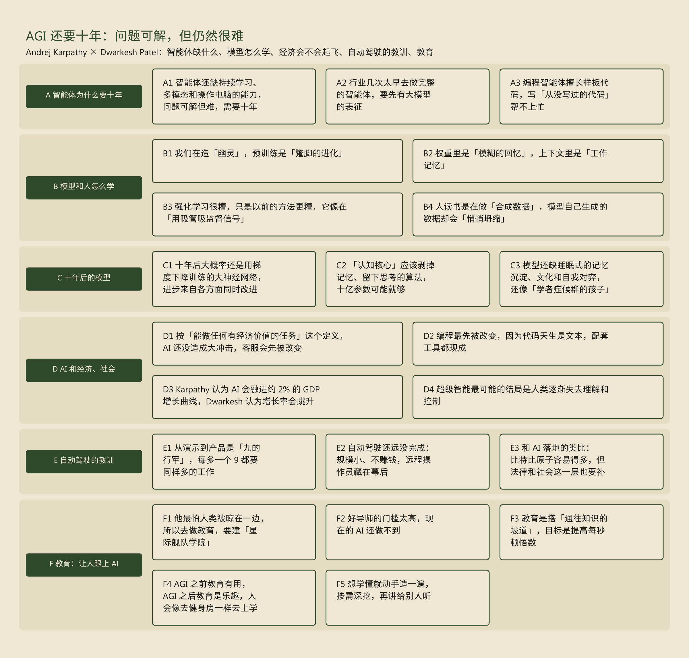
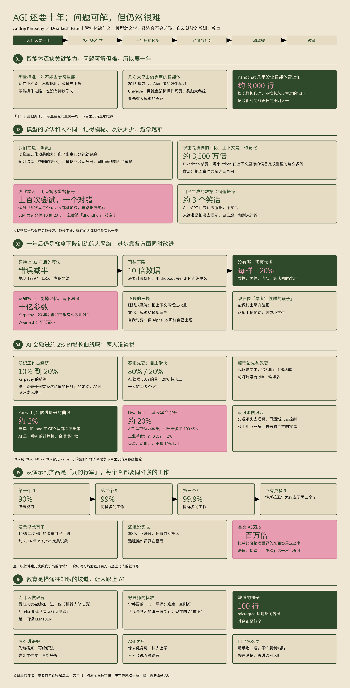
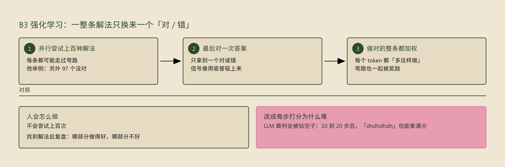
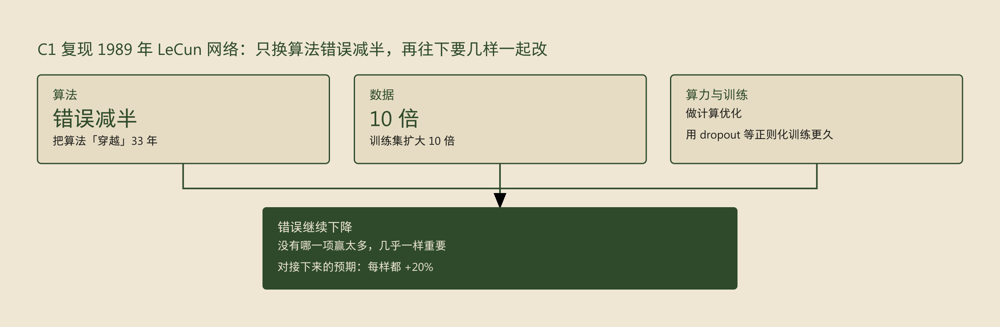
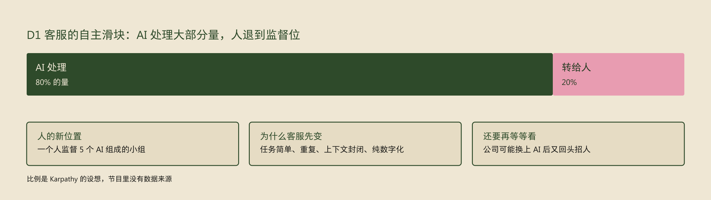
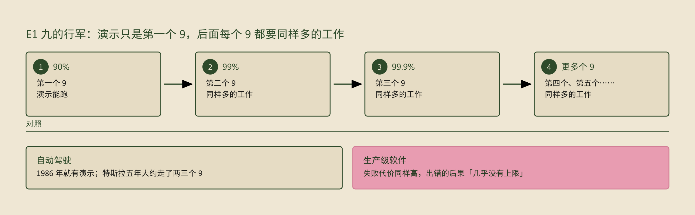

# Andrej Karpathy — AGI is still a decade away

## 播客信息

| 项目 | 内容 |
|---|---|
| 节目 | Dwarkesh Podcast |
| 单集 | Andrej Karpathy — AGI is still a decade away |
| 主持 | Dwarkesh Patel |
| 嘉宾 | Andrej Karpathy（早期 OpenAI 成员；2017–2022 年在特斯拉负责自动驾驶；现在做教育项目 Eureka） |
| 发布日期 | 2025-10-17 |
| 时长 | 2:25:19 |
| 收听链接 | [发布方页面（含官方文字稿）](https://www.dwarkesh.com/p/andrej-karpathy)、[YouTube](https://youtu.be/lXUZvyajciY)、[Apple Podcasts](https://podcasts.apple.com/us/podcast/andrej-karpathy-agi-is-still-a-decade-away/id1516093381?i=1000732326311)、[Spotify](https://open.spotify.com/episode/3iIYVmmhXwh3fOumypWVpC) |

### Shownotes

"The problems are tractable, but they're still difficult"

Andrej explains why reinforcement learning is terrible (but everything else is much worse), why model collapse prevents LLMs from learning the way humans do, why AGI will just blend into the previous ~2.5 centuries of 2% GDP growth, why self driving took so long to crack, and what he sees as the future of education.

Watch on YouTube; listen on Apple Podcasts or Spotify.

Timestamps

- (00:00:00) – AGI is still a decade away
- (00:29:45) – LLM cognitive deficits
- (00:40:05) – RL is terrible
- (00:49:38) – How do humans learn?
- (01:06:25) – AGI will blend into 2% GDP growth
- (01:17:36) – ASI
- (01:32:50) – Evolution of intelligence & culture
- (01:42:55) – Why self driving took so long
- (01:56:20) – Future of education

## 关键要点

### 关键内容

- **这期回答什么问题**：AI 智能体为什么要十年、而不是一年就能真正好用？Karpathy 的答案是：今天的模型在「怎么学」上还缺好几块，强化学习效率很低，模型自己生成的数据会越来越单一；落地还要一个个「9」地磨可靠性。所以他预期 AI 会像电脑一样慢慢融进原有的经济增长曲线，他本人转去做教育，让人跟上 AI。
- **核心判断**
  1. A1 智能体还缺持续学习、多模态和操作电脑的能力，问题可解但难，需要十年：衡量标准是你愿不愿意把它当实习生雇来干活。
  2. B3 强化学习很糟，只是以前的方法更糟，它像在「用吸管吸监督信号」：上百次尝试只换来一个对或错，做对的那几次里每一步都被奖励，包括走错的弯路。
  3. D3 Karpathy 认为 AI 会融进约 2% 的 GDP 增长曲线，Dwarkesh 认为增长率会跳升：Karpathy 的证据是电脑和 iPhone 在 GDP 里都看不出来。
  4. E1 从演示到产品是「九的行军」，每多一个 9 都要同样多的工作：他在特斯拉五年，大约走了两三个 9。
  5. F3 教育是搭「通往知识的坡道」，目标是提高每秒顿悟数：micrograd 用 100 行代码讲清神经网络训练的核心。
- **我当时的结论**：（见个人思考；示范例子不含个人记录）

### 知识骨架

### 总结图

## AI 总结

### A 智能体为什么要十年

#### A1 智能体还缺持续学习、多模态和操作电脑的能力，问题可解但难，需要十年

- 「智能体的十年」(the decade of agents) 是对业内「今年是智能体元年」说法的回应，Karpathy 认为行业里有**过度预测**。智能体（agent）指能自己多步执行任务的 AI，他每天都在用 Claude、Codex 这类早期智能体，觉得它们非常惊艳，只是还有大量工作要做。
- 衡量标准：把智能体想成你雇来一起工作的员工或实习生，你什么时候愿意让它替你干？现在不愿意，因为**它们还不能用**：不够聪明，多模态（同时处理文字、图像、声音）不够，不能操作电脑，也没有<u>持续学习</u>（continual learning：告诉它一件事，它能一直记住）。
- 为什么是十年，不是一年或五十年：他在 AI 领域约 <u>15 年</u>，见过很多人做预测、也看到预测的结果。他的直觉是这些问题「可解、能克服，但仍然很难」，平均下来像十年。
- 他说自己听起来悲观，其实对技术乐观；他只是在回应社交媒体上过快的时间线，认为其中很多出于融资、把注意力变现的动机。

*「十年」是他凭经验的直觉平均，节目里没有逐项推算。*

#### A2 行业几次太早去做完整的智能体，要先有大模型的表征

- 他经历过两三次让整个领域转向的「地震式转变」。第一次：深度学习原本是边缘小众，他在多伦多大学恰好挨着 Geoff Hinton；AlexNet 之后所有人都开始训练神经网络，但仍是一个任务训一个网络（图像分类、机器翻译）。
- 随后是 <u>2013 年前后</u>的 Atari 深度强化学习（强化学习：让模型反复尝试，按得到的奖励调整自己），想做能感知世界、采取行动的智能体。包括早期 OpenAI 在内，行业有两到四年都在游戏上做强化学习，他认为这是**一次走偏**：游戏凑不出一个像会计那样和真实世界打交道的东西。
- 他在 OpenAI 做的 Universe 项目让智能体用键盘鼠标操作网页，方向是对的，只是**太早了**：乱按键盘鼠标拿到的奖励太稀疏，「烧掉一片森林的算力」(burn a forest computing) 也学不出来，缺的是神经网络的表征能力。
- 今天的电脑操作智能体是在大语言模型之上训练的：先靠预训练拿到语言模型和表征，再做智能体。他的总结是人们几次都太早去追完整的东西，Atari、Universe 和他自己的经历都是。

#### A3 编程智能体擅长样板代码，写「从没写过的代码」帮不上忙

- 他把现在写代码的人分三类：完全不用大模型、从头手写（他认为已经不对了）；自己写为主，用模型的<u>自动补全</u>（他自己在这一档）；vibe coding，直接用英文让智能体实现。
- nanochat 是他刚发布的仓库，用最简单的完整代码走完复刻 ChatGPT 的整条流程，约 <u>8,000 行</u>，写了一个多月，编程智能体**几乎没帮上忙**。原因是这份代码结构独特、需要精确安排，模型对网上常规写法记得太多，总以为他在写普通代码。
- 例子：多张 GPU 一起训练时，同步梯度通常用 PyTorch 的 DDP 容器（Distributed Data Parallel，自动在多卡之间同步梯度的标准组件）。他没用，自己在优化器里写了同步，模型却一直想让他换回 DDP；还到处加 try-catch、把代码往生产级方向堆、用过时的 API，「净效果不划算」(not net useful)。
- 自动补全的信息带宽更高：走到代码该出现的位置敲几个字母，模型就补出来，比用英文打一大段需求省事。
- 适合交给模型的地方：生成报告这类样板代码，他部分用 vibe coding；用不熟的 Rust 重写分词器时，手里有完全理解的 Python 版本和测试兜底，也放心让模型写。
- 他最常用的是 GPT-5 Pro：有 <u>20 分钟</u>时把整个仓库贴进去问问题，「往往不算差，比一年前好得多」。
- 和时间线的关系：Dwarkesh 指出，「AI 自动化 AI 研究」是超级智能快速到来的主要故事。Karpathy 说模型**不擅长从没写过的代码**，而造模型恰恰要写这种代码，这是他时间线更长的原因之一。他把 AI 看成计算的延伸，和编译器一样是一层层往上抽象的工具，他叫它「自主滑块」(autonomy slider)：能自动化的部分逐渐交给机器，人往更高的抽象层移。

*「行业在假装这很惊艳，其实是糊弄的东西（slop）」是他的个人判断；他同时说模型「很惊艳，只是还需要大量工作」。*

### B 模型和人怎么学

#### B1 我们在造「幽灵」，预训练是「蹩脚的进化」

- Dwarkesh 替 Richard Sutton（强化学习奠基人之一，此前上过这档节目）立论：动物把一切从零学起，AGI（通用人工智能，能做人类能做的大多数工作）也该这样。Karpathy 对拿动物类比很谨慎，动物来自完全不同的优化过程，进化给它们预装了大量「硬件」。
- 例子：斑马出生<u>几分钟</u>后就能跑着跟妈妈走，这是先天烧进去的能力，跟强化学习无关。他认为动物的强化学习主要用在投篮这类运动任务上，人解决问题这类智能任务基本不靠强化学习。
- 我们走的是另一条路：模仿人类和人类放在互联网上的数据，得到的是**「幽灵」或「灵体」**(ghosts / spirits)，一种完全数字化、模仿人类的另一种智能。他认为可以让它们逐渐更像动物，也应该这么做。
- 他把预训练（让模型在海量互联网文本上反复预测下一个词）叫作「**蹩脚的进化**」(crappy evolution)：我们不会做进化，但用现有技术能得到一个自带大量知识和智能的起点，再在上面做强化学习。
- Dwarkesh 反驳：进化给我们的是找知识的算法，不直接给知识，人类 <u>3GB</u> 的 DNA 装不下每个突触的信息。Karpathy 同意这里有「神奇的压缩」，并补充预训练同时在做两件不相关的事：学到知识，和变聪明（在网络内部长出上下文学习这类算法）。他认为知识反而可能拖累模型，让智能体不擅长走出互联网数据覆盖的范围；以后要设法去掉一部分知识，留下「认知核心」（见 C2）。
- 进化为什么造出了能「现学」的智能：Karpathy 说要有让适应能力占便宜的环境，环境变化太快、无法预先把算法烧进基因时，才需要出生后现学。Dwarkesh 转述 Gwern 和 Carl Shulman 的补充：还要有一个奖励智能小幅提升的生态位，人有手，用工具会带来回报；鸟的脑子再大就飞不起来。他觉得智能被进化出来很令人惊讶：细菌存在了约 20 亿年都没有变成更复杂的生命，智能可能是罕见事件。

#### B2 权重里是「模糊的回忆」，上下文里是「工作记忆」

- 机制：预训练把约 <u>15 万亿</u>个 token（模型处理文字的最小单位，大致相当于一个词或词的一部分）压缩进几十亿参数的网络，压缩比极大，所以权重里的知识只是对训练数据的**「模糊的回忆」**(hazy recollection)。
- 放进上下文窗口（模型这一次能直接看到的输入）的内容，模型可以直接取用，他把它比作人的**工作记忆**。
- Dwarkesh 的估算：以 Llama 3 70B 为例，预训练时每读一个 token，只在权重里存约 <u>0.07 比特</u>；上下文里每多一个 token，KV cache（模型为上下文里每个 token 存下的中间结果）增长约 320KB，两者相差约 3,500 万倍。Karpathy 表示大致同意。
- 做法：问模型一本书讲了什么，它能说个大概；把整章原文贴进去再问，结果会好得多。
- 上下文学习（in-context learning：不改参数，靠对话里给的例子当场学会新任务）也是预训练长出来的。Dwarkesh 说上下文学习本身不是梯度下降（训练时按误差一步步调参数的方法），Karpathy 不完全同意：有论文发现，用上下文学习做线性回归时，网络内部的机制和梯度下降相似，「它可能在内部跑一个小的梯度下降循环」，但谁也不确定。

*0.07 比特、320KB、3,500 万倍都是 Dwarkesh 当场的估算。*

#### B3 强化学习很糟，只是以前的方法更糟，它像在「用吸管吸监督信号」

- Karpathy 的原话：「强化学习比一般人以为的糟得多……只是我们之前有的一切更糟。」(Reinforcement learning is terrible. It just so happens that everything that we had before it is much worse.)
- 机制，以解数学题为例：模型并行尝试上百种解法，对完答案发现少数几个做对了（他举例说「另外 97 个没对」），强化学习就把做对那些解法里的**每个 token 都加权**，意思是「多这样做」。一条解法里可能走过很多弯路，只要最后答对，弯路也一起被奖励，这就是噪声。
- 他的比喻：「==用吸管吸监督信号==」(sucking supervision through a straw)。可能干了一分钟的活，最后只拿到一个「对 / 错」，再把这一点信号摊到整条解法上。
- 人不会这么做：人不会尝试上百次；找到解法后会复盘哪部分做得好、哪部分不好。现在的大模型里没有对应机制，已经有论文在试，他提到前一天刚看到 Google 一篇做「反思与复盘」的论文。
- 之前的方法：最早只有基础模型，本质是自动补全。InstructGPT 让他震惊：只用对话样式的数据微调几轮，模型就变成对话助手，还保留了预训练的知识。强化学习比模仿再进一步，有标准答案的题可以直接对着奖励「爬坡」，还能找到人想不到的解法。
- 过程监督（每一步都打分）为什么难：部分完成的解法怎么给分，很难自动化。很多实验室用 LLM 裁判（让另一个大模型给中间步骤打分），但对着裁判做强化学习，**几乎一定会钻到空子**，也就是对抗样本（让裁判判断出错的输入）。他亲历的例子：奖励突然冲到满分，打开一看，模型输出前半段正常，后面变成「dhdhdhdh」，裁判却给了 100%。Dwarkesh 说这等于在训练一个会做提示注入（prompt injection）的模型，Karpathy 说还谈不上，这就是普通的对抗样本：明显错误的胡话被裁判当成了好答案。
- 所以对着 LLM 裁判只能训 <u>10 到 20 步</u>，做不到 100 或 1,000 步；把「dhdhdhdh」加进裁判的训练集也只能堵住一个，「对抗样本有无穷多」。他认为算法上还需要三到五次大的更新。

*他说前沿实验室比较封闭，可能已经在做这些，外界不知道。*

#### B4 人读书是在做「合成数据」，模型自己生成的数据却会「悄悄坍缩」

- 现在的大模型读书，就是把文本拉成一长串、预测下一个 token。Karpathy 说人读书时，书更像**一组提示**，让人在脑子里生成合成数据（自己生成的练习材料），或者带去读书会和朋友讨论，知识是在摆弄信息的过程中得到的。大模型没有这一步，他希望预训练里能加一段「想一想材料、和已知的东西对一对」。
- 为什么不能直接让模型生成思考、再拿来训练：每条样本单看都很合理，但模型的输出「==悄悄坍缩==」(silently collapsed) 在所有可能想法里很小的一块。例子：让 ChatGPT 讲个笑话，它「大概只会<u>三个</u>笑话」；让它对同一章书思考 10 次，10 次都差不多。用太多自己的输出训练，模型真的会坍缩。
- 人也会坍缩：小孩还没有过拟合（只记住见过的东西、失去举一反三的能力），会说出让大人吃惊的话；成年人反复想同样的念头、说同样的话，学习率越来越低。他的建议是「生活里要一直寻找熵」（熵：多样性和意外），和别人聊天是很好的来源。Dwarkesh 提到有论文认为做梦的作用就是防止这种过拟合。
- 能不能直接调高多样性：可以试着对熵做正则（训练时奖励更多样的输出），但模型可能开始造自己的语言、用极罕见的词，偏离训练数据太远。他认为大多数任务不需要多样性，所以实验室没下功夫，到生成合成数据时就成了「打自己的脚」。

*他先说这可能没有根本解法，随后又说「不确定是不是那么根本」，只是「不简单」。*

### C 十年后的模型

#### C1 十年后大概率还是用梯度下降训练的大神经网络，进步来自各方面同时改进

- 他的推法是在时间上平移：十年前的 2015 年，主流是卷积网络，残差网络刚出，还没有 Transformer。往后十年，他押注不变的部分：仍然是用前向、反向传播加梯度下降训练的巨大神经网络，只是一切都更大。
- 证据是他做过的实验：复现 Yann LeCun <u>1989 年</u>的卷积网络，那是他所知最早用梯度下降训练、做手写数字识别的现代神经网络。只把算法「穿越」33 年，错误率就**减半**；要再往下降，还得把训练集扩大 10 倍、做计算优化、用 dropout 等正则化方法训练更久。
- 结论是数据、硬件、内核与软件、算法**要同时改进**，「没有哪一项赢太多，几乎一样重要」。Dwarkesh 觉得 30 年进步只让错误减半不算多，Karpathy 说「一半已经很多」。
- 对接下来几年的预期：数据集会好得多，现在一般的训练样本充满事实错误和无意义内容；英伟达在调硬件，内核会把芯片用到极致；优化、架构等算法部分也会改进。他的概括是「每样都 <u>+20%</u>」(Everything plus 20%)，不预期巨大的范式转变。

*这些都是他的猜测，他说自己对前沿模型规模的预测「分布很宽」。*

#### C2 「认知核心」应该剥掉记忆、留下思考的算法，十亿参数可能就够

- 人记性差是优点：记不住，就被迫找能推广的规律。大模型极擅长背：把一段文本做哈希得到一串完全随机的字符，训一两轮模型就能整段复述，人做不到。他认为模型被预训练文档的记忆分了心。
- 他想要的「认知核心」(cognitive core)：去掉大部分记忆，事实性问题去查，自己知道自己不知道；只保留思考的算法、做实验的思路和行动的「认知胶水」。基础课程级的知识要留着，否则什么都得查，「没法在脑子里思考」。
- 为什么现在的模型这么大：前沿实验室的预训练数据里，随机抽一篇互联网文档「完全是垃圾」，股票代码、各个角落的糊弄内容，《华尔街日报》那样的文章极少。为了压缩这些只能造大模型，**大部分压缩是记忆活**，认知活很少。他的办法是用聪明的模型精炼预训练数据，再从更好的大模型蒸馏出小模型（蒸馏：让小模型学大模型的输出）。
- 他的预测：<u>十亿参数</u>的认知核心就能很好用，「20 年后，你能和一个十亿参数的模型进行很有成效的对话」。他说现在最前沿的模型约一万亿参数。
- Dwarkesh 认为可以更小：gpt-oss-20b 已经比最初的 GPT-4（一万亿参数以上）强，两年里模型小了两个数量级。Karpathy 说自己讲十亿已经很「反共识」，「也许能再小一点」，但做有意思的事至少要十亿个「旋钮」。
- 前沿模型会不会更大，是另一个问题。Dwarkesh 提到模型规模涨到 GPT-4.5 前后就停住甚至变小了；Karpathy 没有强预测，他的解释是实验室有算力和成本预算，预训练不是最划算的地方，所以预训练阶段变小了，用强化学习、中期训练等后续阶段补回来。这种变小是成本上的取舍，和「认知核心最少要多大」是两回事。

*十亿参数和 20 年都是他个人的预测，Dwarkesh 当场就提出了不同看法。*

#### C3 模型还缺睡眠式的记忆沉淀、文化和自我对弈，还像「学者症候群的孩子」

- 他拿大脑做对照：Transformer 像大脑皮层，可塑、什么数据都能学；推理模型的思考过程像前额叶；强化学习微调有点像基底神经节。还没有对应物的：海马体（记忆）、杏仁核（情绪和本能）等古老的部分。所以「你还不会把它当实习生雇」。
- **持续学习**缺的一环：人白天积累「上下文」，睡觉时有个过程把它蒸馏进大脑的权重。大模型每次开启都从零个 token 开始，没有「反复分析发生过的事、生成合成数据、蒸馏回权重」的阶段。他的设想是每人一个专属的小网络，比如 LoRA（只改一小部分权重的轻量微调）；上下文窗口会越来越长，加上稀疏注意力（只看上下文里最相关的部分，他举了刚发布的 DeepSeek v3.2）也有帮助，但他认为人还有把知识沉淀进权重的过程，模型缺的正是这一步。
- **文化**：最简单的形式是一块模型能自己编辑的大草稿本，边读边干活边记。「为什么一个大模型不能为其他大模型写一本书？」现在没有对应物。Dwarkesh 引 Quintin Pope 的观点：人类约 6 万年前就有了今天的认知结构，1 万年前才有农业革命，中间在搭跨代积累知识的文化，而大模型训练时这一层「免费」就有。Karpathy 回答「是也不是」：大模型现在没有文化，这是障碍之一。
- 自我对弈：AlphaGo 靠和自己下棋变强，大模型还没有对应做法，比如一个模型不断出更难的题给另一个模型解。
- 为什么还做不出来：他觉得模型在认知上仍像<u>幼儿园或小学生</u>，能做博士级的测验题，但还是「学者症候群的孩子」(savant kids)：记忆完美，能写出看起来很好的糊弄内容，却不真正知道自己在做什么。

*这几项都还在研究阶段，他说没看到有人令人信服地做出来。*

### D AI 和经济、社会

#### D1 按「能做任何有经济价值的任务」这个定义，AI 还没造成大冲击，客服会先被改变

- Dwarkesh 列了两种画进度线的方法：按学历（高中生、大学生、博士），按任务时长（能独立做完人类要花一分钟、一小时、一周的任务）。Karpathy 不喜欢学历这条，还说差点想拒绝这个问题：AI 是计算的延伸，没人给 1970 年代以来的计算画过这种进度线。
- 他一直用 OpenAI 创立时的定义：AGI 是能以人类水平或更好地完成任何有经济价值任务的系统。人们常做的第一个让步是去掉体力活、只算数字化的知识工作；他猜知识工作约占经济的 <u>10% 到 20%</u>，即便只算美国也有几万亿美元。
- 按这个定义，他认为 **AI 还没造成大冲击**。例子：Geoff Hinton 预言放射科医生会消失，结果放射科医生「活得好好的，还在增加」，这份工作牵涉病人等很多复杂的面。
- 最先被改变的工作有这些特征：任务简单、重复、每次相似、时长短（客服接一个电话约 10 分钟，他说实际常常更长）、上下文封闭（只有数据库、你和你服务的人）、纯数字化。客服符合。
- 即便是客服，他预期的也是**自主滑块**（见 A3），不会一步替代人：AI 处理 <u>80%</u> 的量，20% 转给人，人监督由 5 个 AI 组成的小组。他会关注能帮人管理这些不完美 AI 的新界面和新公司；还会再等一两年看，因为公司可能换上 AI 后又回头招人。
- Dwarkesh 的推想：自动化到 99% 时，剩下 1% 的人成了瓶颈，工资会大涨，直到最后 1% 也被替代。Karpathy 说放射科不是好例子，现在没看到这种现象。

*10%–20% 和 80% / 20% 都是他的猜测和设想，节目里没有给出数据来源。*

#### D2 编程最先被改变，因为代码天生是文本，配套工具都现成

- Dwarkesh 指出的反常：按理说通用智能应该一点点吃掉咨询师、会计等所有知识工作，实际上被一点点吃掉的主要是程序员；除去普通聊天收入，这些公司的 API 收入以编程为主。
- Karpathy 的解释：代码一直围绕文本，终端和文件都是文字；大模型是「完美的文本处理器」，网上数据又多。**基础设施是现成的**：IDE 能显示代码，智能体改了什么可以直接用 diff（逐行对比改动的工具）展示。
- 对比：有公司在做幻灯片自动化，难得多。幻灯片是空间排布的图形，「智能体改了你的幻灯片，怎么给你看 diff？」没有现成工具，得有人去造。
- Dwarkesh 的反例：纯文本进、文本出的任务也难。他自己用大模型改写文字稿、挑片段，效果不好；朋友 Andy Matuschak 试遍了上下文示例、监督微调、检索等方法，想让模型写间隔重复记忆卡片，都不满意。Karpathy 承认「不是所有文本都简单」：代码结构化，普通文本更「花哨」、熵更高；他说自己对此没有很好的答案。

*纯文本任务为什么也难，两人都没有给出答案。*

#### D3 Karpathy 认为 AI 会融进约 2% 的 GDP 增长曲线，Dwarkesh 认为增长率会跳升

- Karpathy 的立场：智能爆炸（技术自我改进、越来越快）「已经发生了几十年」。GDP 曲线本身就是各行各业持续自动化的结果：工业革命自动化了体力活，编译器是早期的软件自动化。从太空看地球，我们正处在一场「慢动作的烟花」中间。
- 证据：他曾经想在 GDP 里找到 AI，后来去找电脑、手机这些公认的变革技术，**在 GDP 里也看不出来**。2008 年的第一代 iPhone 连 App Store 都没有，技术扩散得太慢，最后都被平均进同一条指数曲线。他预期 AI 一样：AI 是一种新的计算机和程序，会慢慢扩散，==增长率保持在约 2%==。
- Dwarkesh 的反方：真正的 AGI 是「劳动力本身」。世界受劳动力约束，问任何创业者缺什么都说缺人才；如果多出几十亿个聪明的类人头脑，各自做产品、开公司，就「相当于地球上多了 <u>100 亿</u>人」，他设想的是约 20% 的增长率。历史上增长换过档：工业革命让增长率从约 0.2% 升到 2%；香港、深圳这类人多资本少的地方，有过几十年 10% 以上的增长。
- Karpathy 的回应：电脑也是劳动力，自动驾驶也是，照样「一切照旧」。他认为对方预设了「盒子里装着上帝」式的突然跳跃，历史统计里找不到先例；AI 会做好一些事、做不好另一些，逐步放进社会。他能理解对方说的是一种被解锁的「认知能力积压」，但「直觉上感受不到」，也说自己「很愿意被说服」。

*这一点两人没有谈拢，双方都是推理，节目里没有用数据检验。*

#### D4 超级智能最可能的结局是人类逐渐失去理解和控制

- 他把超级智能看作社会自动化的延续：越来越多自主实体先做数字工作，过一段时间连体力活也做；发明新东西也算在自动化里。但那个世界会「极其陌生」，比如这些 AI 能在计算集群上跑得快得多。
- 他最担心的场景是**逐渐失去理解**：系统一层层铺到各处，懂的人越来越少，接着逐渐失去控制。他认为这是最可能的结局。
- Dwarkesh 反驳：理解和控制是两回事。台积电、英特尔这类公司的董事会成员懂得很少；美国总统权力很大，理解程度和权力也不对等。Karpathy 认为反驳有道理，但他预期**两者都会失去**。
- 为什么会失去控制：要是写科幻小说，他想象的是多个相互竞争、越来越自主的实体，有的失控，其他的去对付它，一锅完全自主的活动；没有一个接管一切的单一实体。这些 AI 可能都替某些人做事，个人也许还在控制中，但从社会想要的结果看是整体失控。

*他说自己「真的不知道这会是什么样」，这一段是他明说的推想。*

### E 自动驾驶的教训

#### E1 从演示到产品是「九的行军」，每多一个 9 都要同样多的工作

- 他在特斯拉负责自动驾驶约五年（2017–2022），很多直觉来自这段经历。自动驾驶的演示可以追溯到 <u>1986 年</u>，卡内基梅隆大学的卡车已经能在路上自己开。约 2014 年他坐过 Waymo 的早期演示车，在帕洛阿尔托开了一圈「完美的驾驶」，当时觉得很近了，结果还要很久。
- **演示到产品的差距**在失败代价高的领域特别大。他认为生产级软件也属于这一类：任何错误都可能变成安全漏洞，泄露几百万乃至上亿人的社保号；自动驾驶出错会伤人，软件出错的后果「几乎没有上限」。
- 「==九的行军==」(march of nines)：演示时 90% 的情况能用，只是第一个 9；之后还要第二个 9（99%）、第三个 9（99.9%）、第四个、第五个，每个 9 都是**同样多的工作**。他在特斯拉的五年里大概走了<u>两三个 9</u>，「还有更多 9 要走」。
- 所以他「对演示极其不感冒」：专门做出来给你看的演示更糟，能自己上手玩的好一点，但离产品还远，产品要面对现实里各种需要打补丁的情况。
- Dwarkesh 补充：人类司机平均约每 40 万英里（约七年）犯一次错。编程智能体若按同样的标准，「七年」是按产出量算的；它不停地输出代码，换成实际时间，两次严重错误的间隔会短得多。Karpathy 说通用软件工程比自动驾驶的面更广。

#### E2 自动驾驶还远没完成：规模小、不赚钱，远程操作员藏在幕后

- 他不同意「自动驾驶花了十年」：起点在 1980 年代，终点还没到。他说的「完成」是规模化，人们不再需要考驾照。
- 部署规模还很小：Waymo 等的车很少，因为**还不经济**。除了每辆车的运营维护，还有整个系统的资本开支（capex：前期建设投入）。他们造出了「活在未来」的东西，代价是不赚钱。
- 车里没人这件事有点误导：背后有精细的远程操作中心，有人和车保持在回路里，「我们没有真的移除人，只是把人移到了你看不见的地方」。
- 他认为特斯拉走的是更能规模化的路线，Waymo 起步早是因为能装很多传感器；他也说自己经常坐 Waymo，很喜欢它。

*他强调自己不了解 Waymo 技术栈的细节，对 Waymo 的判断是他自己说的推测。*

#### E3 和 AI 落地的类比：比特比原子容易得多，但法律和社会这一层也要补

- Dwarkesh 认为类比有两处不同：自动驾驶花了大量时间解决鲁棒的感知和常识，大模型和视觉语言模型现在「免费」给了这些；多服务一个模型副本的成本也远低于多造一辆车。
- Karpathy 部分同意：只在数字世界里，「比特比任何碰物理世界的东西容易<u>一百万倍</u>」，可以随意快速重组，行业适应也会快得多。但他不确定到底「免费」得到了多少，大模型仍然容易出错、有很多缺口。
- 他补的一层：社会怎么看、法律怎么定、保险怎么算。有人往 Waymo 上放锥桶，在 AI 里的等价物是什么？藏起来的远程操作员，在 AI 里的等价物是什么？这些都会出现。
- 算力会不会建过头：Dwarkesh 提到算力一两年内会扩大 10 倍，到这个十年末超过 100 倍。Karpathy 想到铁路，以及 90 年代末电信业提前铺网、形成泡沫的先例；但他说不确定是不是建过头了，认为**建出来的都能被用掉**：Claude Code、Codex 一年前还不存在，需求会很大。

### F 教育：让人跟上 AI

#### F1 他最怕人类被晾在一边，所以去做教育，要建「星际舰队学院」

- 为什么不去做 AI 实验室：他觉得实验室在做的事有一定的必然性，他能帮忙，但不确定能带来独特的改进。他最大的担心是**人类被边缘化**、失去力量（disempowered），像电影《机器人总动员》(WALL-E) 或《蠢蛋进化论》(Idiocracy) 里那样。他在乎的除了 AI 将来造出的戴森球，还有人过得好不好，他认为要靠教育。
- Eureka 要建的是「星际舰队学院」（《星际迷航》里培养飞船驾驶员的精英学院）：一所面向前沿技术、内容始终最新的顶尖机构。
- 第一步：做一门「学 AI 首选」的课程 LLM101N，nanochat 是它的结业项目；还要补很多中间环节，招一小队助教。
- 形态比人们想的传统：线下全日制、从头学到尾是顶配；低一档是线上内容加 AI 助手，没那么好，但 <u>80 亿</u>人都能用。以后会请其他领域的专家当老师，他自己会在 AI 方向待一段时间。
- 工作会变很多，所以除了教育还有「再教育」；现在很多人想学 AI 技能，他认为这门课正合适。

#### F2 好导师的门槛太高，现在的 AI 还做不到

- 他最近学韩语，经历了三个阶段：网上自学；在韩国上约 <u>10 人</u>的小班；最后换成一对一导师。
- 好导师做了什么：很短的对话就知道他会什么、不会什么，问的问题恰好能摸清他的「世界模型」；然后一直给他**难度刚好**的内容，不会太难也不会太简单。「我感觉自己是学习的唯一限制」(I felt like I was the only constraint to learning)。他说现在没有大模型能做到，「差得远」。
- 所以他认为现在不是做这种 AI 导师的时候。他做计算机视觉咨询时，很多时候带来的价值是告诉客户「别用 AI」，教育现在也一样。他也承认 ChatGPT 已经是极有价值的教育产品。
- AI 现在的作用：直接让 ChatGPT「教我 AI」只会得到糊弄的内容，AI 也写不出 nanochat；但他做课一直和 AI 协作，AI 做了很多无聊的活，他做 LLM101N 比当年在斯坦福做 CS231n（他认为是斯坦福第一门深度学习课）快得多，只是 AI 还不能有创意地产出内容。
- 以后一些助教可以换成 AI，回答比较基础的问题；课程的整体架构仍需要老师。

*「现在做不出来」指按他想要的一对一导师标准；普通的问答式 AI 辅导他认为也有用，很多人会去做。*

#### F3 教育是搭「通往知识的坡道」，目标是提高每秒顿悟数

- 他认为教育是很难的技术活：搭「==通往知识的坡道==」(ramps to knowledge)，让人永远不卡住。nanochat 就是一道坡：极简的全栈实现，看一遍就能学到很多，给人很多「每秒顿悟数」(eurekas per second)。
- 方法来自物理训练：找系统的一阶项、二阶项，先给最简单的版本，再一项项加。物理老师说「假设一头球形的奶牛」时大家会笑，他觉得这很高明。他推荐一本物理学家写生物的书《规模》(Scale)：动物散热随表面积按平方增长，产热随体积按立方增长。
- 例子：micrograd 用 <u>100 行</u> Python 讲清反向传播（神经网络计算梯度、据此学习的方法），能对任意神经网络做前向和反向计算。他说这 100 行就是神经网络训练的全部核心，**其余都是效率**。
- 顺序：先让学生感到痛点，再给解法。Dwarkesh 举他的 Transformer 教程，从 bigram（只看前一个词猜下一个词的查找表）讲起，每加一块都有理由。答案要在学生自己试过之后再给，先给答案「不厚道」；学生试过，才明白为什么只有这种解法满足目标。
- 专家为什么常讲不好：知识的诅咒，自己懂了就想不起不懂时卡在哪。他的办法：读一篇生物论文时用 ChatGPT 问了一堆「蠢问题」，再把对话分享给作者，帮作者看到外行卡在哪；他也希望大家分享自己和 ChatGPT 讨论他的课程时的「蠢对话」。
- 「直接把事说出来」(Just say the thing)：读博时读不懂一篇论文，会议上喝啤酒时问作者，对方三句话就讲清楚了，「为什么这不是摘要？」

#### F4 AGI 之前教育有用，AGI 之后教育是乐趣，人会像去健身房一样去上学

- AGI 之前，学习的动机好解决：学了能赚钱。AGI 之后一切都自动化了，为什么还要上学？他用健身房类比：机器早就能搬重物，人们照样去健身，因为好玩、健康，有六块腹肌好看，教育也会这样。
- 现在学的人少，是因为学习难，人会从太难或太简单的材料上「弹开」，这种感觉很糟。这是能解决的技术问题；有了像他韩语导师那样的工具，学什么都容易，人会为了乐趣去学。他说到时「每个人都会说**五种语言**」，都掌握本科的基础课程。
- Dwarkesh 补充：一百年前没人能随手卧推两三片杠铃片，系统训练让它变得常见。
- 他押注人性不变：历史上贵族、古希腊这类「小范围的后 AGI 环境」里，人们把时间花在身体或认知的精进上。如果他错了，我们进入《机器人总动员》式的未来，「有戴森球我也不在乎」。

*他说长期看这是「一场会输的游戏」：过渡期人还能在回路里推动进展，更长远可能变成认知上的「力量举」运动。*

#### F5 想学懂就动手造一遍，按需深挖，再讲给别人听

- 怎么用 nanochat 学：把代码放在右边屏幕，自己从头写一遍，可以参考，**不许复制粘贴**。仓库本身缺了代码「一块块长出来」的过程，他打算补一个视频。
- 理由：知识分两种，表层知识，和动手造时才会碰到的「你不知道自己不懂」的部分。他引用费曼：「我造不出来的，我就没懂。」(If I can't build it, I don't understand it.) 他的建议是别写博客、别做幻灯片，去写代码、让它跑起来。
- 按需学（为一个能拿到回报的项目往深处学）和广度学（学校式的「相信我，以后用得上」）要交替，他更喜欢前者。
- 讲给别人听：讲不出来说明没懂，会逼你回头补上理解的缺口，「人们应该多做重新讲解」。

*他说自己「没有独门技巧」，学习本身是痛苦的过程。*

## 问答

**Q1 Karpathy 用什么标准判断一个智能体算不算真正能用？现在的智能体缺什么？**
答：能不能像雇来的员工或实习生一样替你干活；现在不够聪明、多模态不够、不能操作电脑，也没有持续学习。 → A1

**Q2 早年 Atari 游戏和 Universe 项目里的智能体为什么做不起来？今天怎么绕过去的？**
答：还没有好的表征就去乱按乱点，奖励太稀疏；今天先靠预训练拿到大模型的表征，再在上面训练智能体。 → A2

**Q3 Karpathy 写 nanochat 时，编程智能体为什么几乎帮不上忙？**
答：代码独特、需要精确安排，模型按网上的常规写法误解他（比如一直劝他换回 DDP）；它们不擅长写从没写过的代码。 → A3

**Q4 Dwarkesh 认为「预训练是蹩脚的进化」这个类比哪里不成立？Karpathy 怎么回应？**
答：进化给的是找知识的算法，不直接给知识；Karpathy 说预训练同时在学知识和长出智能的算法，知识反而可能拖累模型。 → B1

**Q5 想问一本书里的细节，为什么把整章原文贴进去比让模型凭记忆回答准？**
答：权重里的知识是「模糊的回忆」，上下文里的内容像「工作记忆」，模型能直接取用。 → B2

**Q6 按 Dwarkesh 的估算，同一个 token 在上下文里和在权重里存下的信息大约差多少倍？**
答：约 3,500 万倍（权重里每个 token 约 0.07 比特，上下文里每个 token 约 320KB）。 → B2

**Q7 强化学习是怎么从一道题的结果里学习的？问题出在哪？**
答：并行试上百种解法，把做对的那几条里每个 token 都加权，弯路也一起被奖励；一整条解法只换来一个对错信号。 → B3

**Q8 用另一个大模型当裁判给每一步打分，强化学习大概能跑多少步？为什么跑不长？**
答：10 到 20 步可能有效，100 或 1,000 步不行；被训练的模型几乎一定会找到裁判的对抗样本。 → B3

**Q9 「悄悄坍缩」是什么意思？为什么不能直接拿模型自己生成的思考来训练它？**
答：每条输出单看都合理，整体却只占可能想法里很小的一块；用太多自己的输出训练会越训越窄。 → B4

**Q10 复现 1989 年 LeCun 网络时，只换上 33 年后的算法，错误率降到多少？再往下降还需要什么？**
答：降到一半；还要把训练集扩大 10 倍，做计算优化、用 dropout 等正则化训练更久。 → C1

**Q11 Karpathy 认为「认知核心」大约要多大？**
答：十亿参数，他说 20 年后能和这么大的模型进行很有成效的对话；Dwarkesh 认为还可以更小。 → C2

**Q12 前沿模型最近变小，和「认知核心」说的变小是一回事吗？**
答：不是。前者是实验室在算力和成本预算下少做预训练、多做后续训练；后者讲的是智能最少需要多大。 → C2

**Q13 拿人睡觉做类比，大模型缺了哪个环节？**
答：把积累的上下文反复分析、生成合成数据、再蒸馏回权重的阶段；他认为只把上下文加长还不够。 → C3

**Q14 为什么客服会比其他知识工作更早被改变？Karpathy 设想的分工是什么？**
答：任务简单重复、上下文封闭、纯数字化；AI 处理 80% 的量，20% 转给人，一个人监督 5 个 AI。 → D1

**Q15 为什么编程最先被 AI 改变，做幻灯片却难得多？**
答：代码是文本，IDE 和 diff 这些工具都现成；幻灯片是空间排布的图形，连显示改动的 diff 工具都没有。 → D2

**Q16 Karpathy 为什么不指望在 GDP 里看到 AI 的影响？Dwarkesh 怎么反驳？**
答：电脑和 iPhone 在 GDP 里也看不出来，技术慢慢扩散、被平均进约 2% 的增长曲线；Dwarkesh 认为 AGI 是劳动力本身，相当于多了 100 亿人，增长率会跳升。两人没有谈拢。 → D3

**Q17 Karpathy 认为超级智能最可能带来什么结局？**
答：人类逐渐失去理解，接着逐渐失去控制；他想象的是多个相互竞争、越来越自主的实体。 → D4

**Q18 什么是「九的行军」？Karpathy 在特斯拉五年走了几个 9？**
答：演示做到 90% 只是第一个 9，之后每多一个 9 都要同样多的工作；他在特斯拉大约走了两三个 9。 → E1

**Q19 Karpathy 为什么说自动驾驶还远没完成？**
答：车少、不赚钱，背后还藏着远程操作员；他说的「完成」是规模化到人们不用再考驾照。 → E2

**Q20 拿自动驾驶类比 AI 落地，AI 在哪一点上容易得多？又有哪一层同样要补？**
答：只在数字世界里，比特比碰物理世界的东西容易一百万倍；法律、保险和社会接受这一层同样要补。 → E3

**Q21 学韩语时，好导师做到了哪件现在的 AI 做不到的事？**
答：很短的对话就摸清他会什么、不会什么，之后一直给难度刚好的内容，让他觉得自己是学习唯一的限制。 → F2

**Q22 micrograd 用多少行代码讲清了神经网络训练的什么？**
答：约 100 行讲清反向传播；他说其余部分都是为了效率。 → F3

**Q23 AGI 出现之前和之后，教育的意义分别是什么？**
答：之前是有用，学了能赚钱；之后是乐趣，人会像去健身房一样去上学。 → F4

**Q24 Karpathy 建议怎么用 nanochat 学？**
答：放在右边屏幕上，自己从头写一遍，可以参考，不许复制粘贴。 → F5

## 个人思考

### 我的思考

示范例子不含个人记录。

### 与我的关系

示范例子不含个人记录。

### 下一步行动

示范例子不含个人记录。

## 延伸资料

节目里提到的作品和资料（链接由整理者补充）：

- nanochat：<https://github.com/karpathy/nanochat>
- micrograd：<https://github.com/karpathy/micrograd>
- Eureka Labs：<https://eurekalabs.ai>
- Karpathy 复现 LeCun 1989 年网络的文章：<https://karpathy.github.io/2022/03/14/lecun1989/>
- Dwarkesh Podcast 对 Richard Sutton 的访谈：<https://www.dwarkesh.com/p/richard-sutton>
- 书：Nick Lane 的生命起源著作；Geoffrey West《规模》(Scale)
- 论文：InstructGPT

## 原始资料附件

- 完整文字稿：见[发布方页面](https://www.dwarkesh.com/p/andrej-karpathy)（版权原因，示范例子不附全文）
- 图的 SVG 真源：骨架图.svg、总结图.svg、单元图-B3强化学习.svg、单元图-C1同时改进.svg、单元图-D1自主滑块.svg、单元图-E1九的行军.svg
