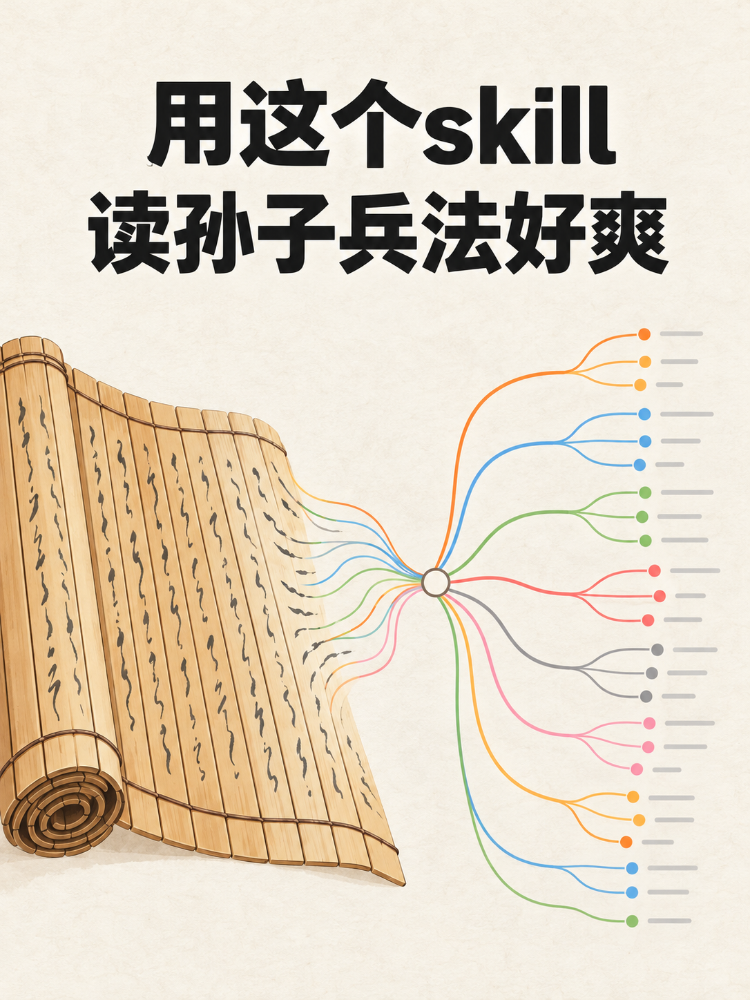

# 示范：一个主题和几张截图 → 一篇能直接发的小红书笔记

日期：2026-10-22 · 使用的 Skill：xhs-note

给 xhs-note 一个主题、几张截图和作者自己的一句想法，拿回一篇小红书笔记：封面、标题、正文、标签都齐。这个例子写的是「让 AI 把《孙子兵法》读成一张思维导图」。

## 给了什么

原样见 [input/主题与想法.md](input/主题与想法.md)。

- 主题：「我让 AI 把《孙子兵法》读成了一张思维导图」
- 配图：两张截图，取自同仓库 book-to-mindmap 的示范例子
  - [input/导图截图.png](input/导图截图.png)：AI 读出来的《孙子兵法》导图
  - [input/原文页截图.png](input/原文页截图.png)：维基文库上的《孙子兵法》原文页
- 作者的想法：

  > 以前读经典，读完只记得几句名言。这次让 AI 先把整本书拆成十几个问题，每个节点写成一句完整的话，不读原书也能看懂它在讲什么。

## 用户会怎么说

在 Claude Code 里，把两张截图放进对话，说一句：

> 想发篇小红书：我让 AI 把《孙子兵法》读成了一张思维导图，配这两张图。我的想法是：以前读经典，读完只记得几句名言。这次让 AI 先把整本书拆成十几个问题，每个节点写成一句完整的话，不读原书也能看懂它在讲什么。

提到小红书、或者拿着截图说想发出去，都会触发 xhs-note。之后按 Skill 的流程走：分体裁 → 收料 → 定角度和标题 → 读范文起草 → 终审 → 封面 → 配图排序 → 标签 → 交付。

这次是示范，只生成，不发布。Skill 平时会把笔记归档进作者的内容库，这次所有产物都写在本目录。

## 代确认的门禁

Skill 里要作者拍板的地方，这次由 AI 扮演作者，一律选 Skill 的推荐项：

- **体裁**：判为工具分享帖（做了个东西，配截图，跟同行说怎么用）。演示时由 AI 按默认确认。
- **收料追问**：作者的想法里没说「用的时候自己要做哪几步」。演示时由 AI 按默认确认：照 book-to-mindmap 那次示范的运行记录回答，不另编经历。
- **标题**：给了几个候选，选第一个，也就是按作者以往工具帖标题写法出的那个。演示时由 AI 按默认确认。
- **要不要封面**：要。演示时由 AI 按默认确认。
- **封面方向**：给了几个方向，选「图形隐喻：竹简上的字变成导图」。演示时由 AI 按默认确认。
- **配图顺序**：封面 → 导图 → 原文页。演示时由 AI 按默认确认。
- **要不要标签**：要，大词、工具词、人群词各打几个。演示时由 AI 按默认确认。

## 得到了什么



**标题**：用这个skill读孙子兵法好爽

**正文**：

```text
以前读经典，读完只记得几句名言。这次让 AI 先把整本书拆成十几个问题，每个节点写成一句完整的话，不读原书也能看懂它在讲什么。

用的是自己做的导图skill，原文是维基文库上的孙子兵法（图2），出来的导图是图1

几个做法：

按读者会问的问题排：要不要打、最好怎么赢、为什么要快、怎么知道敌情、怎么用地形，散在几篇里的同一类内容收进一支，比如讲地形的原本分在行军、地形、九地、九变几篇里

节点写成白话整句：「以迂为直」写成「绕远路反而能先到」，原书术语挪到下一层，扫一遍主干就知道孙子主张啥

原文放备注：节点点开有白话解释和对应原文，引用的原文都逐字核过，有两种读法的地方标了问号，两种说法都列上

查漏：另开一个看不到原文的agent，只看导图答题，答不全的回去补，不过它本来就熟孙子兵法，只能算个参考

我要做的事情就收敛成了：
1. 把原文丢给cc，说一句帮我做成思维导图
2. 它先出骨架，看一眼分支是不是我想问的问题，不对就改
3. 打开xmind扫一遍主干，哪支感兴趣再点开看原文

导图毕竟是ai读出来的，拿不准的地方还是对着原文看一眼

大家读经典有啥好办法也求分享啊
antonailog/skills/book-to-mindmap
```

**标签**：#思维导图 #孙子兵法 #读书笔记 #skill #claudecode #xmind

| 文件 | 内容 |
|---|---|
| [output/note.md](output/note.md) | 标题和候选、正文、标签、配图索引、封面方向、备注 |
| [output/最终配图/](output/最终配图/) | 按上传顺序排好的图：`00-封面.png`、`01.png`（导图，正文里的图1）、`02.png`（原文页，正文里的图2） |
| [output/图片/封面.prompt.md](output/图片/封面.prompt.md) | 封面的生图 prompt，可以拿去重新生成 |

## 过程里值得一看的地方

- **作者的原话一字没改**：放在开头，连句号都留着。Skill 的规矩是作者动过笔的句子原样保留。
- **只写真发生过的事**：正文里的细节只来自作者的想法和 book-to-mindmap 那次示范的运行记录，没有引外部的说法。
- **不夸大**：导图是 AI 读出来的。正文写的是原文引用逐字核过、有两种读法的地方标了问号、查漏的办法只能算参考，最后提醒读者拿不准的地方对着原文看。
- **缺的料不编**：Skill 要求结尾放一句作者的真实感受，这次作者没给，就没有替他编，换成了上面那句提醒。作者发布前可以换成自己的话。
- **封面生图换了调用方式**：封面按 Skill 写的流程交给本机 Codex 内置生图。照 Skill 文档里的命令原样跑没跑通：文档指定的那份 Codex 命令行版本太旧，不支持本机现在配置的模型；命令里附图参数写在 prompt 前面，会把 prompt 当成图片吞掉。改用本机全局规则里的 Codex 调用方式，并把 prompt 和附图参数分开后，生成成功。封面上的标题逐字核对过，没有错字。没有走 Skill 的兜底方案（只留 prompt、封面待生成）。
